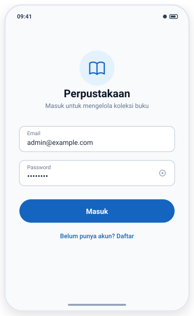
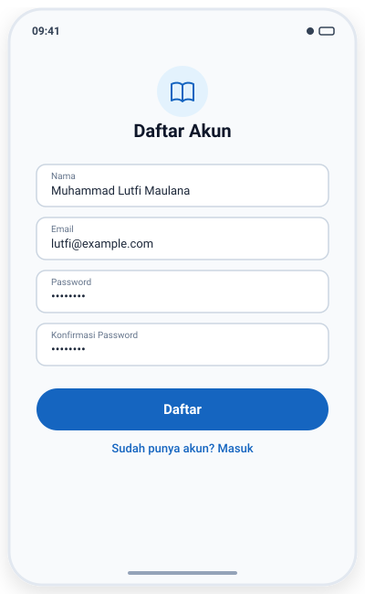
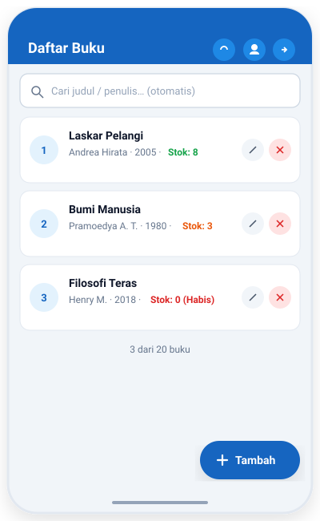
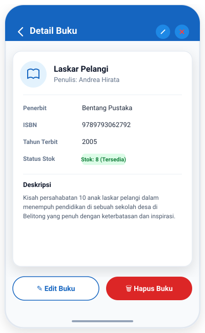
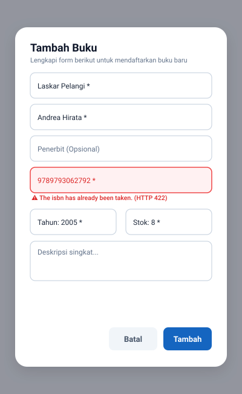
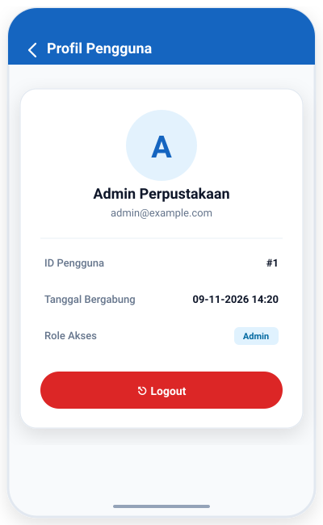
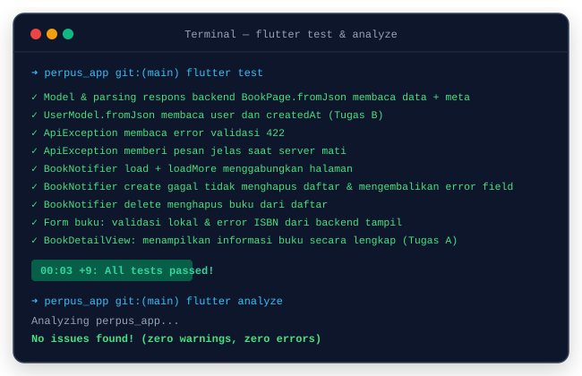

# 📚 Perpustakaan App — Modern Library Management System

[](https://flutter.dev)
[](https://dart.dev)
[](https://riverpod.dev)
[](https://pub.dev/packages/dio)
[](https://laravel.com)
[](https://laravel.com/docs/sanctum)
[](https://sqlite.org)
[](perpus_app/test/widget_test.dart)

Aplikasi manajemen perpustakaan modern berbasis **Flutter** dan **Laravel REST API** dengan implementasi arsitektur **MVVM (Model-View-ViewModel)**, **Riverpod Notifier State Management**, dan **Laravel Sanctum Bearer Token Authentication**. Dibangun untuk platform **Android** dan **Web Browser** dari satu codebase yang sama.

---

## 📱 Tangkapan Layar Aplikasi (App Screenshots)

| 1. Login | 2. Registrasi | 3. Daftar Buku & Pencarian |
| :---: | :---: | :---: |
|  |  |  |

| 4. Detail Buku (Tugas A) | 5. Form & Validasi 422 | 6. Profil User (Tugas B) |
| :---: | :---: | :---: |
|  |  |  |

### 🧪 Bukti Hasil Pengujian Otomatis (`flutter test` & `flutter analyze`)
<p align="center">
  
</p>

---

## ✨ Fitur Utama (Key Features)

- 🔐 **Autentikasi Aman Laravel Sanctum:**
  - Registrasi pengguna baru (`POST /api/register`).
  - Login berbasis Bearer Token (`POST /api/login`) yang tersimpan aman di `SharedPreferences` dengan in-memory cache.
  - Sesi otomatis dipulihkan saat aplikasi dibuka kembali via `SplashView` (`GET /api/me`).
  - Interceptor HTTP yang otomatis mengarahkan ke halaman login jika token kedaluwarsa (`401 Unauthorized`).
  - Logout aman (`POST /api/logout`) dengan penghapusan token lokal terjamin (`finally block`).
- 📚 **Manajemen Koleksi Buku (CRUD):**
  - **Pencarian Cerdas (Debounce 500ms):** Mengurangi beban server dengan menunda query 500 ms setelah pengetikan selesai. Dilengkapi pencegahan *race-condition* dengan `_requestId`.
  - **Paginasi & Infinite Scroll:** Otomatis memuat data buku halaman berikutnya saat menggulir ke bawah.
  - **Status Stok Dinamis:** Indikator visual real-time (Merah untuk Habis, Oranye untuk $\le 5$, Hijau untuk $> 5$).
  - **Detail Buku Terpadu:** Menampilkan seluruh metadata buku (Penerbit, ISBN, Tahun, Deskripsi) dengan aksi cepat Edit & Hapus.
  - **Penanganan Error Validasi (HTTP 422):** Menangkap validasi server (seperti ISBN duplikat) dan menampilkannya langsung di bawah input tanpa menutup dialog modal.
- 👤 **Profil Pengguna Responsif:**
  - Menampilkan informasi akun, ID, email, dan tanggal bergabung (`createdAt`).
  - Terintegrasi pada AppBar (Mobile) dan NavigationRail (Desktop/Web).
- 📱 **UI Responsif (Adaptive Layout):**
  - Mobile: Layout single-column dengan Floating Action Button (FAB).
  - Tablet/Desktop: NavigationRail sidebar dengan constraint konten terpusat.

---

## 🏛️ Arsitektur Aplikasi (MVVM + Riverpod)

Proyek ini menerapkan arsitektur **MVVM (Model-View-ViewModel)** dengan pemisahan tanggung jawab yang ketat dan aliran data searah (*unidirectional data flow*):

```
┌────────────────────────────────────────────────────────┐
│               Layer View (Flutter UI)                  │
│   SplashView · LoginView · RegisterView · BooksView    │
│            BookDetailView · ProfileView                │
└───────────────────────────▲────────────────────────────┘
                            │ ref.watch / ref.read
┌───────────────────────────┴────────────────────────────┐
│         Layer ViewModel (Riverpod Notifiers)           │
│             AuthNotifier  ·  BookNotifier              │
└───────────────────────────▲────────────────────────────┘
                            │ panggil method
┌───────────────────────────┴────────────────────────────┐
│                   Layer Repository                     │
│            AuthRepository · BookRepository             │
└───────────────────────────▲────────────────────────────┘
                            │ DTO parsing & services
┌───────────────────────────┴────────────────────────────┐
│               Layer Services & Network                 │
│         ApiService · DioClient · StorageService        │
└───────────────────────────▲────────────────────────────┘
                            │ HTTP Request (Bearer Token)
┌───────────────────────────┴────────────────────────────┐
│              Remote Server (Laravel 12 API)            │
│         Sanctum Auth · SQLite Database · JSON          │
└────────────────────────────────────────────────────────┘
```

---

## 📋 Pemenuhan Tugas & Latihan Modul (Pertemuan 11)

Seluruh instruksi pada [panduan.md](panduan.md) dan laporan pada [jawaban_latihan.md](jawaban_latihan.md) telah diselesaikan:

| Tugas / Latihan | Status | Lokasi Kode / File | Keterangan |
| :--- | :---: | :--- | :--- |
| **Latihan 1 — Swagger UI** | ✅ | Backend (`/api/documentation`) | Verifikasi endpoint dan analisis respons 422. |
| **Latihan 2 — Tracing Data** | ✅ | [jawaban_latihan.md](jawaban_latihan.md) | Diagram alur sequence Mermaid 13 langkah (sukses & 422). |
| **Latihan 3 — Warna Stok** | ✅ | [book_card.dart](perpus_app/lib/widgets/book_card.dart) | Stok 0 = Merah, $\le 5$ = Oranye, $> 5$ = Hijau. |
| **Tugas A — Detail Buku** | ✅ | [book_detail_view.dart](perpus_app/lib/views/books/book_detail_view.dart) | Halaman detail buku lengkap + tombol Edit & Hapus. |
| **Tugas B — Profil User** | ✅ | [profile_view.dart](perpus_app/lib/views/profile/profile_view.dart)<br>[user_model.dart](perpus_app/lib/models/user_model.dart) | Field `createdAt`, endpoint `GET /api/me`, UI profil. |
| **Tugas C — Debounce & Analisis** | ✅ | [books_view.dart](perpus_app/lib/views/books/books_view.dart) | Debounce 500ms + analisis race condition `_requestId`. |
| **Pengujian Otomatis** | ✅ | [widget_test.dart](perpus_app/test/widget_test.dart) | 9 unit & widget tests lulus 100%. |

---

## 🛠️ Struktur Direktori Proyek

```
Tugas pertemuan 11/
├── perpus-api/                      # Backend Laravel 12
│   ├── app/Models/                  # Book & User Eloquent Models
│   ├── app/Http/Controllers/Api/    # AuthController & BookController
│   ├── database/database.sqlite     # SQLite Database
│   └── routes/api.php               # RESTful API Endpoints
│
├── perpus_app/                      # Frontend Flutter 3
│   ├── lib/
│   │   ├── core/                    # Constants, Dio client, Exception, Router, Theme
│   │   ├── models/                  # UserModel & BookModel (+ BookPage)
│   │   ├── services/                # ApiService & StorageService
│   │   ├── repositories/            # AuthRepository & BookRepository
│   │   ├── viewmodels/              # Riverpod Notifiers (auth_vm, book_vm, providers)
│   │   ├── views/
│   │   │   ├── auth/                # SplashView, LoginView, RegisterView
│   │   │   ├── books/               # BooksView, BookDetailView, BookFormDialog
│   │   │   └── profile/             # ProfileView
│   │   ├── widgets/                 # ResponsiveLayout, AuthScaffold, BookCard
│   │   └── main.dart                # Entry point & ProviderScope
│   └── test/
│       └── widget_test.dart         # Unit & Widget Tests
│
├── screenshots/                     # Mockup & Screenshot UI Aplikasi
├── panduan.md                       # Modul praktikum pertemuan 11
└── jawaban_latihan.md               # Laporan detail jawaban latihan & tugas
```

---

## 🚀 Panduan Menjalankan Proyek (Getting Started)

### Prasyarat:
- [Flutter SDK](https://flutter.dev) (v3.24+ / Dart 3.5+)
- [PHP](https://www.php.net) (v8.2+) & [Composer](https://getcomposer.org)
- Ekstensi PHP yang aktif: `pdo_sqlite`, `curl`, `mbstring`, `openssl`

### 1. Menjalankan Backend Laravel (`perpus-api`)
```bash
# Pindah ke direktori backend
cd perpus-api

# Salin konfigurasi environment & buat file database
cp .env.example .env
touch database/database.sqlite

# Pasang dependensi & jalankan migrasi database
composer install
php artisan key:generate
php artisan migrate:fresh --seed

# Jalankan server lokal
php artisan serve
# Server aktif di: http://127.0.0.1:8000
```
> **Akun Default Admin:**  
> Email: `admin@example.com` | Password: `password`

### 2. Menjalankan Frontend Flutter (`perpus_app`)
Buka terminal baru di direktori `perpus_app`:
```bash
# Pindah ke direktori Flutter
cd perpus_app

# Pasang paket dependensi
flutter pub get

# Jalankan di Web (Google Chrome)
flutter run -d chrome

# ATAU jalankan di Emulator Android
flutter run -d emulator-5554
```

> **Catatan Endpoint API:**  
> - Chrome / Web Browser: Otomatis memakai `http://localhost:8000/api`.  
> - Emulator Android: Otomatis memakai `http://10.0.2.2:8000/api` (alias localhost komputer host).  
> - Device Fisik: Gunakan flag `--dart-define=API_BASE_URL=http://<IP-KOMPUTER>:8000/api`.

---

## 🧪 Menjalankan Pengujian (Testing)

Untuk memastikan seluruh fungsi berjalan dengan baik tanpa kendala:

```bash
# Masuk ke direktori Flutter
cd perpus_app

# 1. Analisis statis kode (Linter)
flutter analyze
# Output: No issues found!

# 2. Menjalankan seluruh Unit & Widget Test
flutter test
# Output: All tests passed! (9 passed)
```

Untuk menguji backend Laravel:
```bash
cd perpus-api
php artisan test
# Output: Tests: 9 passed (40 assertions)
```

---

## 👨‍💻 Identitas Pengembang (Author)
- **Nama:** Muhammad Lutfi Maulana
- **NIM / Identitas:** *(Dapat ditambahkan NIM Anda di sini)*
- **Mata Kuliah:** Mobile Programming (Pertemuan 11)
- **GitHub:** [@lutfim123](https://github.com/lutfim123)

---

## 📄 Lisensi
Proyek ini dibuat untuk keperluan akademik dan pembelajaran di bawah lisensi [MIT](LICENSE).
