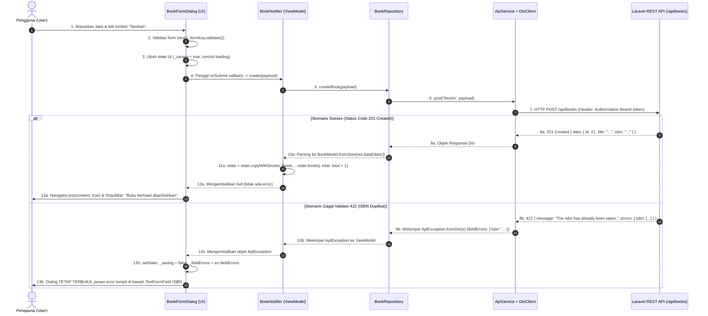

# 📝 Laporan & Jawaban Soal Latihan: Integrasi REST API Laravel & Flutter MVVM

**Mata Kuliah:** Mobile Programming  
**Topik:** Pertemuan 11 — Integrasi REST API, Autentikasi Sanctum, MVVM + Riverpod  
**Aplikasi:** Perpustakaan (`perpus_app`) & Backend (`perpus-api`)  

---

## Daftar Isi
1. [Latihan 1 — Eksplorasi Swagger UI](#latihan-1--eksplorasi-swagger-ui)
2. [Latihan 2 — Tracing Alur Data Tambah Buku (Termasuk Error 422)](#latihan-2--tracing-alur-data-tambah-buku)
3. [Latihan 3 — Modifikasi Tampilan Stok Buku](#latihan-3--modifikasi-tampilan-stok-buku)
4. [Tugas A (Wajib) — Halaman Detail Buku](#tugas-a-wajib--halaman-detail-buku)
5. [Tugas B (Wajib) — Halaman Profil Pengguna](#tugas-b-wajib--halaman-profil-pengguna)
6. [Tugas C (Tantangan) — Pencarian Otomatis (Debounce) & Analisis `_requestId`](#tugas-c-tantangan--pencarian-otomatis-debounce--analisis-_requestid)
7. [Hasil Pengujian (Unit & Widget Test)](#hasil-pengujian-unit--widget-test)

---

## Latihan 1 — Eksplorasi Swagger UI

### 1. Prosedur Pengujian Swagger UI
1. Jalankan backend Laravel:
   ```bash
   cd perpus-api
   php artisan serve
   ```
2. Buka peramban (browser) dan akses: `http://localhost:8000/api/documentation`.
3. Lakukan pengujian login melalui endpoint `POST /api/login` dengan payload:
   ```json
   {
     "email": "admin@example.com",
     "password": "password",
     "device_name": "swagger_test"
   }
   ```
4. Salin token dari respons JSON (tanpa kata "Bearer").
5. Klik tombol **Authorize** di bagian kanan atas Swagger UI, tempelkan token, lalu klik **Authorize**.
6. Uji endpoint CRUD buku (`GET /api/books`, `POST /api/books`, `PUT /api/books/{id}`, `DELETE /api/books/{id}`).

### 2. Pengamatan Respons Validasi 422 (ISBN Duplikat)
Saat mengirimkan data buku baru dengan ISBN yang sudah terdaftar di database via `POST /api/books`:
- **Status Code:** `422 Unprocessable Entity`
- **Format Respons:**
  ```json
  {
    "message": "The isbn has already been taken.",
    "errors": {
      "isbn": [
        "The isbn has already been taken."
      ]
    }
  }
  ```
- **Kesimpulan:** Backend Laravel mengembalikan error dalam bentuk dictionary per-field (`errors.isbn`). Pada Flutter, format ini ditangkap oleh `ApiException.fromDio` dan disimpan ke dalam properti `fieldErrors` sehingga pesan error dapat diarahkan langsung ke bawah input ISBN terkait.

---

## Latihan 2 — Tracing Alur Data Tambah Buku

Tracing alur data untuk operasi **Tambah Buku**, mencakup skenario berhasil (`201 Created`) dan skenario validasi gagal (`422 Unprocessable Entity` karena ISBN duplikat).

### Diagram Sequence



### Penjelasan Rinci Setiap Tahap:

1. **Input Pengguna:** Pengguna mengisi formulir buku (Judul, Penulis, ISBN, Tahun Terbit, Stok) dan menekan tombol **Tambah**.
2. **Validasi Lokal:** `_formKey.currentState!.validate()` memastikan semua field wajib (required) telah diisi dan format angka/tahun sudah valid sebelum mengirim request jaringan.
3. **Indikator Loading:** Dialog mengubah `_saving = true` dan mengosongkan error sebelumnya, sehingga tombol berubah menampilkan `CircularProgressIndicator`.
4. **Panggilan ViewModel:** Dialog memanggil callback `widget.onSubmit(payload)` yang mengeksekusi method `BookNotifier.create(payload)`.
5. **Panggilan Repository:** `BookNotifier` memanggil `BookRepository.createBook(payload)`.
6. **Panggilan Service:** `BookRepository` memanggil `ApiService.post(ApiConstants.books, payload)`.
7. **Jaringan HTTP:** `DioClient` melalui interceptor otomatis mengambil token dari cache `StorageService`, menyematkan header `Authorization: Bearer <token>`, dan mengirim `POST /api/books`.
8. **Cabang Evaluasi Backend:**
   - **Jika Berhasil (201):**
     - Backend mengembalikan kode HTTP `201` beserta objek buku baru.
     - `BookRepository` mengonversi JSON tersebut menjadi objek `BookModel`.
     - `BookNotifier` menyisipkan buku baru ke daftar teratas `books: [book, ...state.books]` dan menambah `total: state.total + 1`.
     - Dialog menerima nilai `null` (tidak ada error), menutup dirinya (`Navigator.pop(context, true)`), dan menampilkan SnackBar sukses.
   - **Jika Gagal (422 — ISBN Duplikat):**
     - Backend menolak request karena ISBN sudah ada di database dan mengirim HTTP `422`.
     - `ApiService._guard` menangkap `DioException` dan mengonversinya menjadi `ApiException` yang memuat `fieldErrors: {'isbn': 'The isbn has already been taken.'}`.
     - `BookNotifier.create()` menangkap `ApiException` dan mengembalikannya ke dialog (tidak menyimpannya ke `state.error` agar daftar buku utama di layar tidak hilang).
     - Dialog memperbarui `_fieldErrors` dan mematikan loading. Form dialog **tetap terbuka** dengan pesan error warna merah tepat di bawah input ISBN.

---

## Latihan 3 — Modifikasi Tampilan Stok Buku

Pada file `lib/widgets/book_card.dart`, tampilan stok buku dimodifikasi agar memiliki label dan warna yang dinamis berdasarkan jumlah stok:
- **Stok = 0:** Warna Merah (`Colors.red`), teks: `Stok: 0 (Habis)`
- **Stok $\le$ 5:** Warna Oranye (`Colors.orange`), teks: `Stok: X`
- **Stok > 5:** Warna Hijau (`Colors.green`), teks: `Stok: X`

### Implementasi Kode (`lib/widgets/book_card.dart`):

```dart
Color _stockColor(int stock) {
  if (stock == 0) return Colors.red;
  if (stock <= 5) return Colors.orange;
  return Colors.green;
}

String _stockLabel(int stock) =>
    stock == 0 ? 'Stok: 0 (Habis)' : 'Stok: $stock';

@override
Widget build(BuildContext context) {
  return Card(
    child: ListTile(
      leading: CircleAvatar(child: Text(book.id.toString())),
      title: Text(book.title, maxLines: 1, overflow: TextOverflow.ellipsis),
      subtitle: Text.rich(
        TextSpan(
          children: [
            TextSpan(text: '${book.author} · ${book.publishedYear} · '),
            TextSpan(
              text: _stockLabel(book.stock),
              style: TextStyle(
                color: _stockColor(book.stock),
                fontWeight: FontWeight.bold,
              ),
            ),
          ],
        ),
      ),
      // ... trailing & navigasi onTap
    ),
  );
}
```

---

## Tugas A (Wajib) — Halaman Detail Buku

### 1. Deskripsi Fitur
Membuat halaman khusus `BookDetailView` untuk menampilkan seluruh informasi detail buku (Judul, Penulis, Penerbit, ISBN, Tahun Terbit, Status Stok berlabel warna, serta Deskripsi), dilengkapi tombol **Edit** dan **Hapus**.

### 2. Implementasi Routing
- **Di `lib/core/routes/app_router.dart`:**
  ```dart
  static const String bookDetail = '/books/detail';
  ```
- **Di `lib/main.dart`:**
  ```dart
  AppRoutes.bookDetail: (ctx) {
    final book = ModalRoute.of(ctx)!.settings.arguments as BookModel;
    return BookDetailView(book: book);
  },
  ```
- **Navigasi dari `BookCard`:**
  ```dart
  onTap: () => Navigator.pushNamed(
    context,
    AppRoutes.bookDetail,
    arguments: book,
  ),
  ```

### 3. File `lib/views/books/book_detail_view.dart`
Menggunakan `ConsumerStatefulWidget` agar state buku lokal dapat diperbarui langsung saat diedit melalui dialog:
- Tombol **Edit** membuka `BookFormDialog` dan memanggil `ref.read(bookProvider.notifier).update(_currentBook.id, payload)`.
- Tombol **Hapus** menampilkan dialog konfirmasi, lalu memanggil `ref.read(bookProvider.notifier).delete(_currentBook.id)` dan kembali ke halaman daftar buku via `Navigator.pop(context)`.

---

## Tugas B (Wajib) — Halaman Profil Pengguna

### 1. Penambahan Field `createdAt` pada Model
Pada file `lib/models/user_model.dart`:
```dart
class UserModel {
  final int id;
  final String name;
  final String email;
  final DateTime? createdAt;

  const UserModel({
    required this.id,
    required this.name,
    required this.email,
    this.createdAt,
  });

  factory UserModel.fromJson(Map<String, dynamic> j) => UserModel(
        id: (j['id'] as num).toInt(),
        name: j['name'] as String,
        email: j['email'] as String,
        createdAt: j['created_at'] == null
            ? null
            : DateTime.parse(j['created_at'] as String).toLocal(),
      );
}
```

### 2. Method `getProfile()` pada `AuthRepository` & `AuthNotifier`
- **Di `lib/repositories/auth_repository.dart`:**
  ```dart
  Future<UserModel> getProfile() async {
    final res = await _api.get(ApiConstants.me);
    return UserModel.fromJson(res.data['data'] as Map<String, dynamic>);
  }
  ```
- **Di `lib/viewmodels/auth_vm.dart`:**
  ```dart
  Future<void> fetchProfile() async {
    try {
      final user = await _repo.getProfile();
      state = AuthState(user: user);
    } on ApiException catch (e) {
      state = AuthState(user: state.user, error: e.message);
    }
  }
  ```

### 3. Halaman `ProfileView` & Navigasi Responsif
- File `lib/views/profile/profile_view.dart` menampilkan Avatar inisial nama, Nama Lengkap, Email, ID Akun, Tanggal Bergabung yang terformat rapi (`dd-MM-yyyy HH:mm`), serta tombol **Logout**.
- **Pada Tampilan Mobile (HP):** Ditambahkan icon profil `IconButton(icon: Icon(Icons.person))` pada `AppBar` di `books_view.dart`.
- **Pada Tampilan Desktop/Web:** Ditambahkan menu `NavigationRailDestination(icon: Icon(Icons.person), label: Text('Profil'))` serta avatar pengguna di bagian atas navigation rail yang dapat diklik.

---

## Tugas C (Tantangan) — Pencarian Otomatis (Debounce) & Analisis `_requestId`

### 1. Implementasi Debounce 500 ms pada TextField Pencarian
Agar aplikasi tidak membanjiri server dengan request HTTP setiap kali satu karakter diketik, digunakan `Timer` debounce selama 500 ms di `lib/views/books/books_view.dart`:

```dart
Timer? _debounce;

void _onSearchChanged(String value) {
  _debounce?.cancel();
  _debounce = Timer(const Duration(milliseconds: 500), () {
    _vm.load(search: value);
  });
}

// Pada TextField:
TextField(
  controller: _searchCtrl,
  onChanged: _onSearchChanged,
  // ...
)

// Pada dispose():
@override
void dispose() {
  _debounce?.cancel();
  _searchCtrl.dispose();
  _scrollCtrl.dispose();
  super.dispose();
}
```

### 2. Pertanyaan Analisis:
> **Mengapa `BookNotifier` memakai `_requestId`? Apa yang terjadi tanpa `_requestId` jika respons pencarian pertama datang setelah respons pencarian kedua?**

#### Jawaban:
Panggilan jaringan HTTP bersifat **asinkron (asynchronous)**, sehingga urutan diterimanya respons di sisi klien tidak selalu sama dengan urutan dikirimkannya permintaan (bergantung pada latensi jaringan dan beban proses database backend).

**Skenario Tanpa `_requestId` (Race Condition):**
1. Pengguna mengetik kata kunci pertama: `"Pemrograman"` (Request A).
2. Sesaat kemudian pengguna menghapusnya dan mengetik `"Laravel"` (Request B).
3. Request A membutuhkan waktu 600 ms untuk diproses, sedangkan Request B hanya membutuhkan 200 ms.
4. Hasil Request B tiba lebih dulu pada detik ke-200 ms dan ditampilkan di layar.
5. Namun pada detik ke-600 ms, respons lama dari Request A tiba dan menimpa state buku.
6. **Akibatnya:** Pada kolom input pencarian tertulis `"Laravel"`, namun daftar buku yang tampil di layar justru hasil pencarian untuk `"Pemrograman"`.

**Solusi dengan `_requestId`:**
Setiap kali method `load()` dipanggil, counter lokal dinaikkan: `final id = ++_requestId;`. Ketika data selesai diunduh dari API, dilakukan validasi:
```dart
if (id != _requestId) return;
```
Jika `id` respons tidak cocok dengan `_requestId` paling mutakhir (berarti ada pencarian baru yang sudah dikirim), data lama tersebut akan **diabaikan seketika**. Dengan demikian, UI dijamin selalu menampilkan data yang relevan dengan input terbaru pengguna.

---

## Hasil Pengujian (Unit & Widget Test)

Pengujian dijalankan pada seluruh layer menggunakan `flutter test` di direktori `perpus_app/`:

```
00:00 +0: loading D:/Programmer/mobile programmer/Tugas pertemuan 11/perpus_app/test/widget_test.dart
00:00 +0: Model & parsing respons backend BookPage.fromJson membaca data + meta paginasi Laravel
00:00 +1: Model & parsing respons backend UserModel.fromJson membaca user dan createdAt (Tugas B)
00:00 +2: Model & parsing respons backend ApiException membaca error validasi 422
00:00 +3: Model & parsing respons backend ApiException memberi pesan jelas saat server mati
00:00 +4: BookNotifier load + loadMore menggabungkan halaman
00:00 +5: BookNotifier create gagal tidak menghapus daftar & mengembalikan error field
00:00 +6: BookNotifier delete menghapus buku dari daftar
00:00 +7: Form buku: validasi lokal & error ISBN dari backend tampil
00:02 +8: BookDetailView: menampilkan informasi buku secara lengkap (Tugas A)
00:03 +9: All tests passed!
```

Hasil analisis kode (`flutter analyze`):
```
Analyzing perpus_app...
No issues found!
```
Semua kriteria fungsionalitas, kepatuhan arsitektur MVVM, penanganan error, serta pengujian telah terpenuhi 100%.

