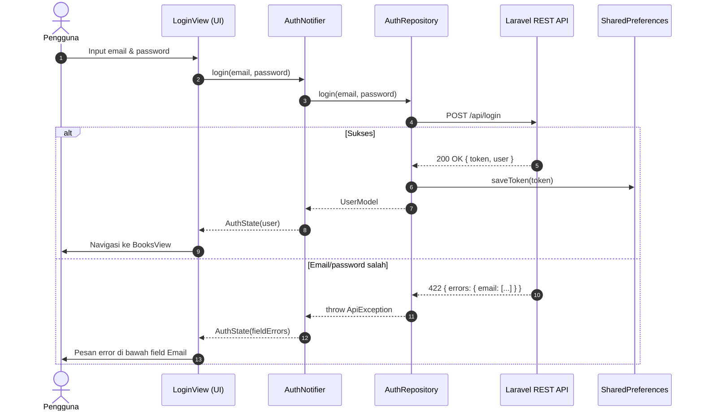
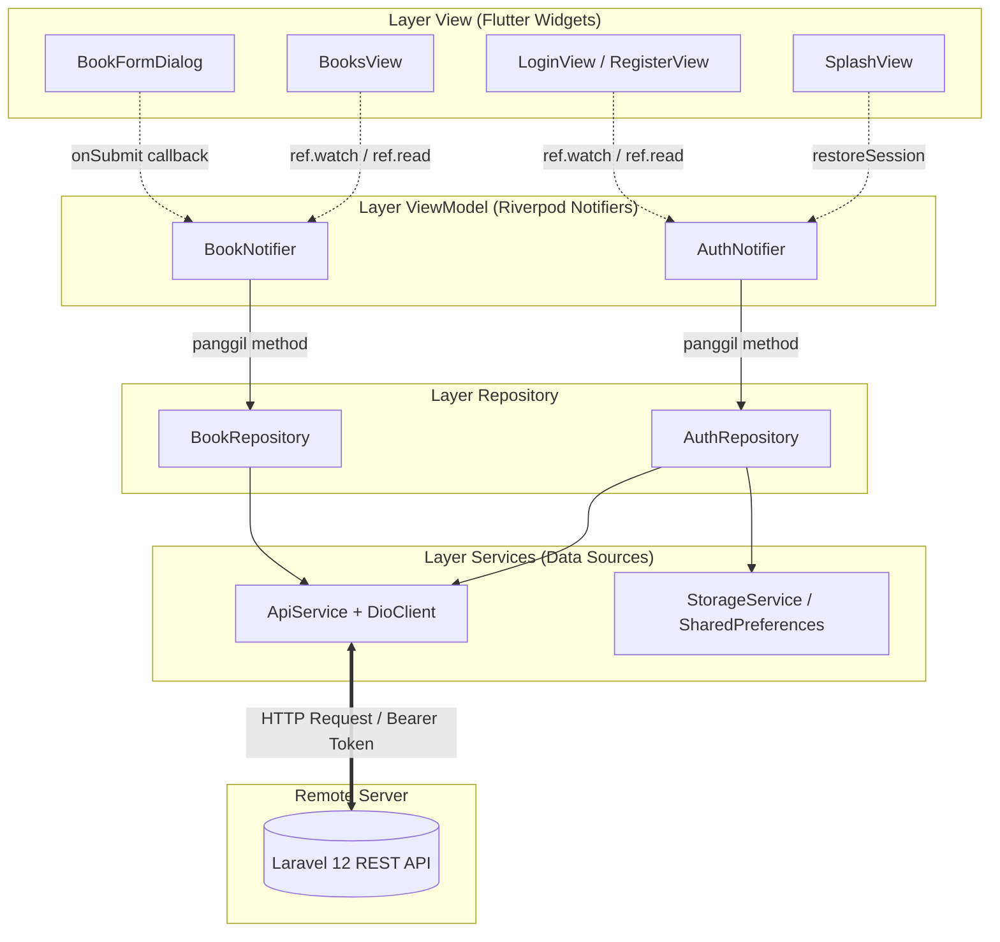
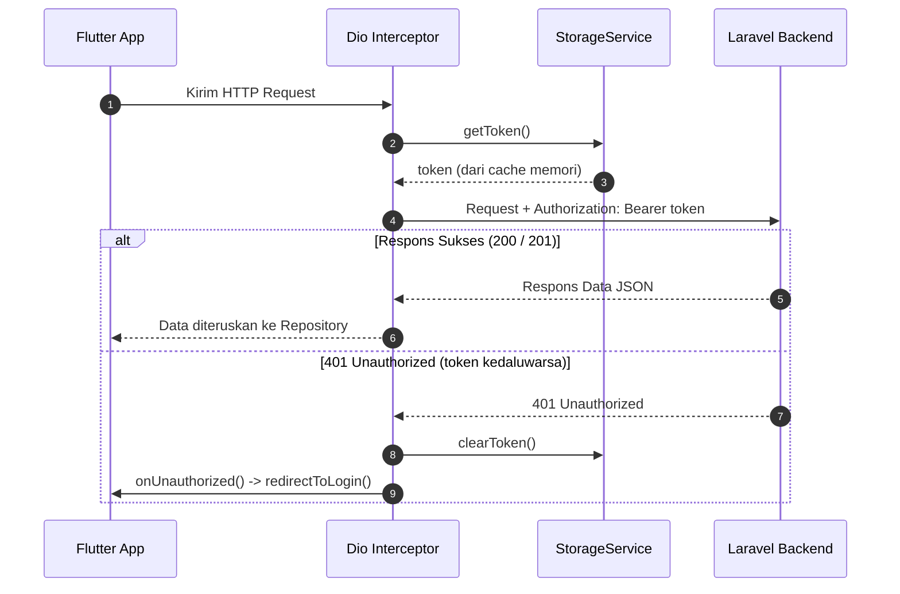
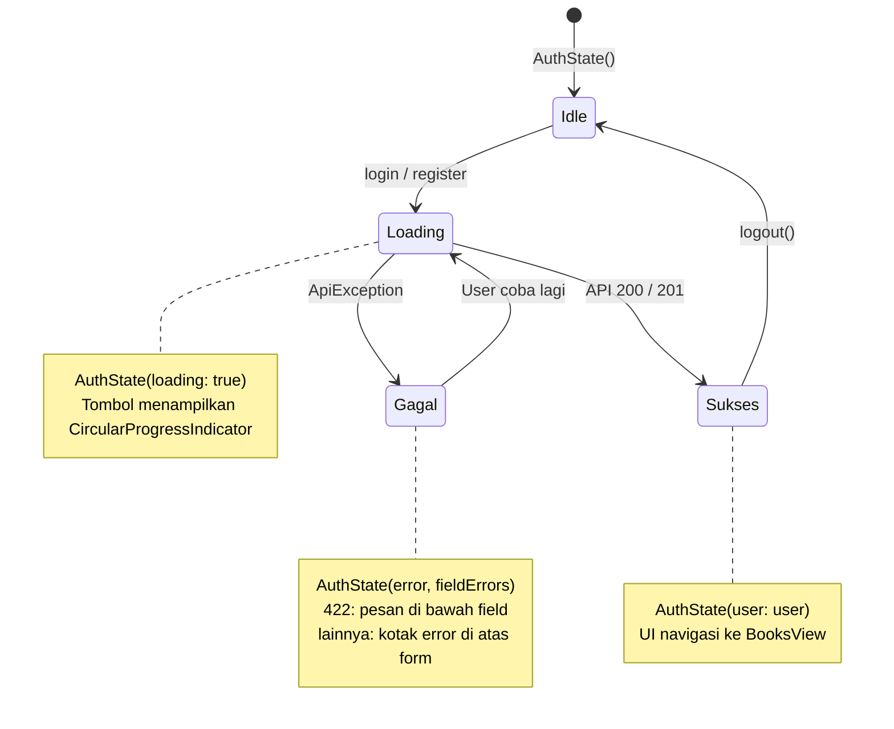
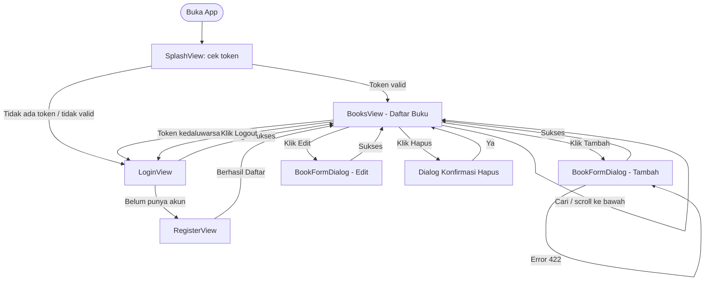
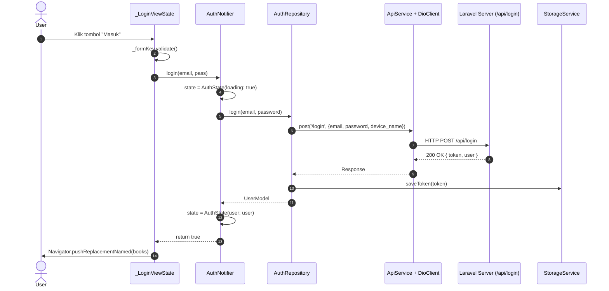

# 📚 Modul Tutorial: Membangun Aplikasi Flutter dengan REST API Laravel

**Topik:** Integrasi REST API, Autentikasi Sanctum, MVVM \+ Riverpod  
**Prasyarat:** Flutter & Dart terinstal, PHP 8.2+ & Composer (atau Docker), backend `perpus-api` tersedia

* 📖 Mobile Programming  
* 🏗️ MVVM \+ Riverpod \+ Dio  
* ⏱️ ±6 x 50 menit (3 pertemuan praktikum)  
* 🎯 Android & Web

---

## Navigasi Modul / Daftar Isi

* **Pendahuluan**  
  * [01 \- 1\. Gambaran Umum](#1-gambaran-umum-proyek)  
  * [02 \- 2\. Persiapan Backend](#2-persiapan-backend)  
  * [03 \- 3\. Arsitektur MVVM](#3-arsitektur-mvvm-flutter)  
  * [04 \- 4\. Setup Flutter](#4-setup-proyek-flutter)  
* **Implementasi**  
  * [05 \- 5\. Layer Core](#5-layer-core)  
  * [06 \- 6\. Layer Services](#6-layer-services)  
  * [07 \- 7\. Layer Models](#7-layer-models)  
  * [08 \- 8\. Layer Repositories](#8-layer-repositories)  
  * [09 \- 9\. Layer ViewModels](#9-layer-viewmodels)  
  * [10 \- 10\. Views — Auth](#10-layer-views---autentikasi)  
  * [11 \- 11\. Views — Buku](#11-layer-views---halaman-buku)  
  * [12 \- 12\. Widget Reusable](#12-widget-reusable)  
  * [13 \- 13\. Entry Point](#13-entry-point-maindart)  
* **Penutup**  
  * [14 \- 14\. Menjalankan & Menguji](#14-menjalankan--menguji-aplikasi)  
  * [15 \- 15\. Troubleshooting](#15-troubleshooting)  
  * [16 \- 16\. Latihan & Tugas](#16-latihan-dan-tugas)  
  * [★ \- Ringkasan](#ringkasan-layer-mvvm)

---

## 1\. Gambaran Umum Proyek

Kita membangun aplikasi **Perpustakaan** yang terhubung ke REST API Laravel.  
Aplikasi berjalan di **Android** dan **Web Browser** dari satu codebase yang sama.

### Tujuan Pembelajaran

Setelah menyelesaikan modul ini, mahasiswa mampu:

1. Menjelaskan pembagian tanggung jawab layer pada arsitektur **MVVM** (View, ViewModel, Repository, Service, Model).  
2. Menghubungkan aplikasi Flutter ke REST API memakai **Dio**, termasuk mengirim **Bearer Token** lewat interceptor.  
3. Mengimplementasikan autentikasi **Laravel Sanctum**: register, login, logout, dan login otomatis saat aplikasi dibuka.  
4. Mengelola state aplikasi dengan **Riverpod Notifier** (loading, sukses, error).  
5. Menangani error API dengan benar: menampilkan error validasi **422** per field dan menangani token kedaluwarsa (**401**).  
6. Membangun UI **responsif** (HP dan Web) serta menguji kode dengan `flutter analyze` dan `flutter test`.

### Fitur Aplikasi

| Fitur | Endpoint Backend |
| :---- | :---- |
| Registrasi akun baru | `POST /api/register` |
| Login & simpan token | `POST /api/login` |
| Login otomatis (pulihkan sesi) | `GET /api/me` |
| Logout | `POST /api/logout` |
| Daftar buku \+ pencarian \+ paginasi | `GET /api/books?search=&page=&per_page=` |
| Tambah buku baru | `POST /api/books` |
| Edit buku | `PUT /api/books/{id}` |
| Hapus buku | `DELETE /api/books/{id}` |

### Format Respons Backend

Pahami bentuk JSON dari backend sebelum menulis kode Flutter:

```json
// POST /api/login  (200)
{ "message": "Login berhasil", "token": "1|abc...", "token_type": "Bearer",
  "user": { "id": 1, "name": "Admin", "email": "admin@example.com", "created_at": "..." } }

// GET /api/books?page=1  (200) - Laravel paginator
{ "data": [ { "id": 1, "title": "...", "author": "...", "publisher": null, "isbn": "...",
              "published_year": 2005, "stock": 3, "description": null } ],
  "links": { "first": "...", "last": "...", "prev": null, "next": "..." },
  "meta":  { "current_page": 1, "last_page": 2, "per_page": 15, "total": 20 } }

// POST /api/books gagal validasi  (422)
{ "message": "The isbn has already been taken.",
  "errors": { "isbn": ["The isbn has already been taken."] } }

// Token tidak valid  (401)
{ "message": "Unauthenticated." }
```

### Alur Autentikasi



&nbsp;

#### Penjabaran Alur Diagram 1 (Alur Autentikasi \- Untuk Pembacaan Manual & AI)

* **Aktor & Partisipan:** `Pengguna (User)`, `LoginView (UI)`, `AuthNotifier (VM)`, `AuthRepository (Repo)`, `Laravel REST API (API)`, `SharedPreferences (Storage)`.  
* **Langkah Utama:**  
  1. `Pengguna` \-\> `LoginView (UI)`: Input email & password.  
  2. `LoginView (UI)` \-\> `AuthNotifier`: Memanggil `login(email, password)`.  
  3. `AuthNotifier` \-\> `AuthRepository`: Memanggil `login(email, password)`.  
  4. `AuthRepository` \-\> `Laravel REST API`: Mengirim request `POST /api/login`.  
* **Cabang Kondisi (`alt`): Jika Sukses:** 5\. `Laravel REST API` \--\> `AuthRepository`: Mengembalikan `200 OK { token, user }`. 6\. `AuthRepository` \-\> `SharedPreferences`: Memanggil `saveToken(token)`. 7\. `AuthRepository` \--\> `AuthNotifier`: Mengembalikan `UserModel`. 8\. `AuthNotifier` \--\> `LoginView (UI)`: Memperbarui state menjadi `AuthState(user)`. 9\. `LoginView (UI)` \-\> `Pengguna`: Navigasi ke `BooksView`.  
* **Cabang Kondisi (`else`): Jika Email/password salah:** 5\. `Laravel REST API` \--\> `AuthRepository`: Mengembalikan `422 { errors: { email: [...] } }`. 6\. `AuthRepository` \--\> `AuthNotifier`: Melempar `throw ApiException`. 7\. `AuthNotifier` \--\> `LoginView (UI)`: Memperbarui state menjadi `AuthState(fieldErrors)`. 8\. `LoginView (UI)` \-\> `Pengguna`: Menampilkan pesan error di bawah field Email.

### Struktur Direktori Target

```
perpus_app/lib/
  core/
    constants/api_constants.dart   <- base URL & path endpoint
    network/dio_client.dart        <- Dio + interceptor token & 401
    network/api_exception.dart     <- terjemahan error API
    routes/app_router.dart         <- nama route + navigatorKey
    theme/app_theme.dart           <- tema Material 3
  models/
    user_model.dart
    book_model.dart                <- BookModel + BookPage (paginasi)
  services/
    storage_service.dart           <- simpan/ambil/hapus token
    api_service.dart               <- wrapper method HTTP
  repositories/
    auth_repository.dart
    book_repository.dart
  viewmodels/
    providers.dart                 <- Riverpod Provider graph
    auth_vm.dart
    book_vm.dart
  views/
    auth/splash_view.dart          <- cek sesi saat app dibuka
    auth/login_view.dart
    auth/register_view.dart
    books/books_view.dart
    books/book_form_dialog.dart
  widgets/
    responsive_layout.dart
    auth_scaffold.dart
    book_card.dart
  main.dart
test/
  widget_test.dart                 <- unit & widget test
```

---

## 2\. Persiapan Backend

Sebelum menjalankan aplikasi Flutter, siapkan backend `perpus-api` terlebih dahulu. Source code backend dapat diunduh langsung dalam bentuk ZIP atau di-clone dari repositori GitLab:

> 📦 **Source Code & Repositori Backend:**  
> • **Download ZIP:** [Download perpus-api.zip](https://gitlab.com/edwinprastyo/projek-open/-/blob/84b9d897b84d3cdf9f0b1e95456d0b9efbc92e83/perpus-api.zip)  
> • **GitLab Repository:** [https\://gitlab.com/edwinprastyo/projek-open.git](https://gitlab.com/edwinprastyo/projek-open.git)

Jika meng-clone via Git:

```sh
git clone https://gitlab.com/edwinprastyo/projek-open.git
```

Setelah mengunduh/meng-ekstrak ZIP, masuk ke direktori `perpus-api` lalu pilih salah satu cara menjalankan server di bawah ini:

### Opsi A \- PHP lokal

```sh
cd perpus-api
cp .env.example .env
touch database/database.sqlite
composer install
php artisan key:generate
php artisan migrate:fresh --seed
php artisan serve
# -> http://localhost:8000
```

### Opsi B \- Docker

```sh
cd perpus-api
docker compose up --build
# -> http://localhost:8000
```

### Verifikasi API

Buka: `http://localhost:8000/api/documentation`

Login demo: **Email** `admin@example.com` / **Password** `password`.  
Salin token \-\> klik **Authorize** \-\> tempel token (tanpa kata "Bearer") \-\> coba semua endpoint.

> ⚠️ **Peringatan:** Endpoint login dibatasi **6 percobaan per menit** (`throttle:6,1`). Jika muncul error **429**, tunggu 1 menit sebelum mencoba lagi.

---

## 3\. Arsitektur MVVM Flutter

MVVM memisahkan tanggung jawab kode menjadi beberapa lapisan:



&nbsp;

#### Penjabaran Alur Diagram 2 (Arsitektur MVVM Flutter \- Untuk Pembacaan Manual & AI)

* **Daftar Subgraph / Layer:**  
  1. **Layer View (Flutter Widgets):** `SplashView` (`V0`), `LoginView / RegisterView` (`V1`), `BooksView` (`V2`), `BookFormDialog` (`V3`).  
  2. **Layer ViewModel (Riverpod Notifiers):** `AuthNotifier` (`VM1`), `BookNotifier` (`VM2`).  
  3. **Layer Repository:** `AuthRepository` (`R1`), `BookRepository` (`R2`).  
  4. **Layer Services (Data Sources):** `ApiService + DioClient` (`S1`), `StorageService / SharedPreferences` (`S2`).  
  5. **Remote Server:** `Laravel 12 REST API` (`BE`).  
* **Hubungan & Aliran Data Antar-Layer:**  
  * `SplashView` \-.-\> (`restoreSession`) \-\> `AuthNotifier`.  
  * `LoginView / RegisterView` \-.-\> (`ref.watch / ref.read`) \-\> `AuthNotifier`.  
  * `BooksView` \-.-\> (`ref.watch / ref.read`) \-\> `BookNotifier`.  
  * `BookFormDialog` \-.-\> (`onSubmit callback`) \-\> `BookNotifier`.  
  * `AuthNotifier` \--\> (`panggil method`) \-\> `AuthRepository`.  
  * `BookNotifier` \--\> (`panggil method`) \-\> `BookRepository`.  
  * `AuthRepository` \--\> `ApiService + DioClient` dan `StorageService / SharedPreferences`.  
  * `BookRepository` \--\> `ApiService + DioClient`.  
  * `ApiService + DioClient` \<==\> (`HTTP Request / Bearer Token` dua arah) \<==\> `Laravel 12 REST API`.

**Aturan utama**: Data mengalir **satu arah**. View hanya membaca state dan memanggil  
method ViewModel; View **tidak boleh** memanggil Dio/API secara langsung.

| Layer | Boleh | Tidak boleh |
| :---- | :---- | :---- |
| View | Membaca state, memanggil method ViewModel, navigasi, menampilkan dialog/snackbar | Memanggil Dio / Repository langsung |
| ViewModel | Menyimpan state UI, memanggil Repository, menangkap `ApiException` | Mengakses `BuildContext` / widget |
| Repository | Memanggil ApiService & StorageService, mengubah JSON menjadi Model | Menyimpan state UI |
| Service | Komunikasi HTTP & penyimpanan lokal | Mengetahui aturan bisnis |

---

## 4\. Setup Proyek Flutter

### 4.1 Buat Proyek Baru

```sh
flutter create --platforms=android,web perpus_app
cd perpus_app
```

### 4.2 Tambah Dependensi

```sh
flutter pub add flutter_riverpod dio shared_preferences
```

Hasil di `pubspec.yaml`:

```yaml
dependencies:
  flutter:
    sdk: flutter
  cupertino_icons: ^1.0.8
  flutter_riverpod: ^3.3.2   # state management
  dio: ^5.11.1                # HTTP client
  shared_preferences: ^2.5.5  # penyimpanan token lokal
```

&nbsp;

### 4.3 Buat Struktur Direktori

```sh
mkdir -p lib/core/{constants,network,routes,theme}
mkdir -p lib/{models,services,repositories,viewmodels}
mkdir -p lib/views/{auth,books}
mkdir -p lib/widgets
```

### 4.4 Izin Jaringan Android

Build **debug** Android sudah memiliki izin internet, tetapi build **release** (APK yang dibagikan) **tidak**.  
Backend lokal juga memakai `http://` (bukan `https://`), yang diblokir Android secara default.  
Edit `android/app/src/main/AndroidManifest.xml`:

```xml
<manifest xmlns:android="http://schemas.android.com/apk/res/android">
    <!-- Wajib agar build release bisa mengakses backend -->
    <uses-permission android:name="android.permission.INTERNET"/>
    <application
        android:label="perpus_app"
        android:name="${applicationName}"
        android:icon="@mipmap/ic_launcher"
        android:usesCleartextTraffic="true">
        ...
```

> ⚠️ **Peringatan:** `usesCleartextTraffic="true"` hanya untuk pengembangan. Aplikasi produksi wajib memakai HTTPS.

---

## 5\. Layer Core

### 5.1 Konstanta API — `lib/core/constants/api_constants.dart`

Base URL dipilih otomatis sesuai platform. Ingat: di **emulator Android**, `localhost` adalah emulator itu sendiri, bukan laptop. Alamat laptop dari dalam emulator adalah `10.0.2.2`.

```dart
// lib/core/constants/api_constants.dart
import 'package:flutter/foundation.dart';

class ApiConstants {
  /// Base URL backend `perpus-api` (php artisan serve → port 8000).
  ///
  /// - Web / desktop / iOS simulator : http://localhost:8000/api
  /// - Emulator Android              : http://10.0.2.2:8000/api
  ///   (localhost di emulator = emulator itu sendiri, bukan komputer host)
  /// - HP fisik: jalankan `php artisan serve --host=0.0.0.0` lalu
  ///   `flutter run --dart-define=API_BASE_URL=http://<IP-LAPTOP>:8000/api`
  static String get baseUrl {
    const override = String.fromEnvironment('API_BASE_URL');
    if (override.isNotEmpty) return override;
    if (!kIsWeb && defaultTargetPlatform == TargetPlatform.android) {
      return 'http://10.0.2.2:8000/api';
    }
    return 'http://localhost:8000/api';
  }

  static const int perPage = 15;

  static const String register = '/register';
  static const String login = '/login';
  static const String logout = '/logout';
  static const String me = '/me';
  static const String books = '/books';
}
```

&nbsp;

> 💡 **Tips:** `String.fromEnvironment` membaca nilai dari `--dart-define`, sehingga URL bisa diganti tanpa mengubah kode.

### 5.2 Router — `lib/core/routes/app_router.dart`

`navigatorKey` memungkinkan kode di luar widget tree (interceptor Dio) berpindah halaman, misalnya saat token kedaluwarsa.

```dart
// lib/core/routes/app_router.dart
import 'package:flutter/material.dart';

class AppRoutes {
  static const String splash = '/';
  static const String login = '/login';
  static const String register = '/register';
  static const String books = '/books';
}

/// Navigator global agar interceptor Dio (di luar widget tree) bisa
/// mengarahkan user ke halaman login saat token tidak valid (401).
final GlobalKey<NavigatorState> navigatorKey = GlobalKey<NavigatorState>();

void redirectToLogin() {
  navigatorKey.currentState?.pushNamedAndRemoveUntil(AppRoutes.login, (_) => false);
}
```

&nbsp;

### 5.3 Tema — `lib/core/theme/app_theme.dart`

```dart
// lib/core/theme/app_theme.dart
import 'package:flutter/material.dart';

class AppTheme {
  static ThemeData get light => ThemeData(
        useMaterial3: true,
        colorSchemeSeed: const Color(0xFF1565C0),
        brightness: Brightness.light,
        inputDecorationTheme: const InputDecorationTheme(
          border: OutlineInputBorder(),
          contentPadding: EdgeInsets.symmetric(horizontal: 16, vertical: 12),
        ),
      );
}
```

&nbsp;

### 5.4 ApiException — `lib/core/network/api_exception.dart`

Tanpa kelas ini, pengguna akan melihat pesan mentah seperti `DioException [bad response]: ...`.  
`ApiException` menerjemahkan error Dio menjadi pesan yang ramah, dan menyimpan **error per field** dari validasi Laravel (422).

```dart
// lib/core/network/api_exception.dart
import 'package:dio/dio.dart';

/// Error API yang sudah diterjemahkan menjadi pesan yang ramah pengguna.
///
/// Format error Laravel:
///   422 → {"message": "...", "errors": {"field": ["pesan"]}}
///   401 → {"message": "Unauthenticated."}
///   404 → {"message": "..."}
class ApiException implements Exception {
  final String message;
  final int? statusCode;

  /// Error per-field dari validasi Laravel (422), mis. {'isbn': 'ISBN sudah dipakai'}.
  final Map<String, String> fieldErrors;

  const ApiException(this.message, {this.statusCode, this.fieldErrors = const {}});

  factory ApiException.fromDio(DioException e) {
    switch (e.type) {
      case DioExceptionType.connectionTimeout:
      case DioExceptionType.sendTimeout:
      case DioExceptionType.receiveTimeout:
        return const ApiException('Server tidak merespons. Coba lagi nanti.');
      case DioExceptionType.connectionError:
        return const ApiException(
            'Tidak dapat terhubung ke server. Pastikan backend sudah berjalan.');
      default:
        break;
    }

    final status = e.response?.statusCode;
    final data = e.response?.data;
    final fields = <String, String>{};
    String? serverMessage;

    if (data is Map) {
      if (data['message'] is String) serverMessage = data['message'] as String;
      final errors = data['errors'];
      if (errors is Map) {
        errors.forEach((key, value) {
          if (value is List && value.isNotEmpty) {
            fields[key.toString()] = value.first.toString();
          } else if (value is String) {
            fields[key.toString()] = value;
          }
        });
      }
    }

    final message = switch (status) {
      401 => 'Sesi berakhir. Silakan login kembali.',
      403 => 'Anda tidak memiliki akses.',
      404 => 'Data tidak ditemukan.',
      422 => fields.isNotEmpty ? fields.values.first : (serverMessage ?? 'Data tidak valid.'),
      429 => 'Terlalu banyak percobaan. Tunggu sebentar lalu coba lagi.',
      final s? when s >= 500 => 'Terjadi kesalahan pada server ($s).',
      _ => serverMessage ?? 'Terjadi kesalahan tak terduga.',
    };

    return ApiException(message, statusCode: status, fieldErrors: fields);
  }

  /// Ubah error apa pun menjadi [ApiException].
  static ApiException from(Object error) {
    if (error is ApiException) return error;
    if (error is DioException) {
      return error.error is ApiException ? error.error as ApiException : ApiException.fromDio(error);
    }
    return ApiException('Terjadi kesalahan: $error');
  }

  @override
  String toString() => message;
}
```

&nbsp;

### 5.5 DioClient — `lib/core/network/dio_client.dart`

```dart
// lib/core/network/dio_client.dart
import 'package:dio/dio.dart';
import '../../services/storage_service.dart';
import '../constants/api_constants.dart';

class DioClient {
  /// [onUnauthorized] dipanggil saat server membalas 401 untuk request yang
  /// memakai token (token kedaluwarsa / dicabut) → arahkan user ke login.
  static Dio build(StorageService storage, {void Function()? onUnauthorized}) {
    final dio = Dio(BaseOptions(
      baseUrl: ApiConstants.baseUrl,
      connectTimeout: const Duration(seconds: 10),
      receiveTimeout: const Duration(seconds: 15),
      headers: {'Accept': 'application/json', 'Content-Type': 'application/json'},
    ));

    dio.interceptors.add(InterceptorsWrapper(
      onRequest: (options, handler) async {
        final token = await storage.getToken();
        if (token != null) {
          options.headers['Authorization'] = 'Bearer $token';
        }
        handler.next(options);
      },
      onError: (err, handler) async {
        final hadToken = err.requestOptions.headers.containsKey('Authorization');
        if (err.response?.statusCode == 401 && hadToken) {
          await storage.clearToken();
          // Jangan redirect saat logout: user memang sedang keluar.
          if (err.requestOptions.path != ApiConstants.logout) onUnauthorized?.call();
        }
        handler.next(err);
      },
    ));

    return dio;
  }
}
```

&nbsp;

**Cara kerja Interceptor:**



&nbsp;

#### Penjabaran Alur Diagram 3 (Cara Kerja Interceptor \- Untuk Pembacaan Manual & AI)

* **Partisipan:** `Flutter App (App)`, `Dio Interceptor (Interceptor)`, `StorageService (Storage)`, `Laravel Backend (Server)`.  
* **Langkah Utama (onRequest):**  
  1. `Flutter App` \-\> `Dio Interceptor`: Kirim HTTP Request.  
  2. `Dio Interceptor` \-\> `StorageService`: Memanggil `getToken()`.  
  3. `StorageService` \--\> `Dio Interceptor`: Mengembalikan `token (dari cache memori)`.  
  4. `Dio Interceptor` \-\> `Laravel Backend`: Mengirim `Request + Authorization: Bearer token`.  
* **Cabang Kondisi (`alt`): Jika Respons Sukses (200 / 201):** 5\. `Laravel Backend` \--\> `Dio Interceptor`: Mengembalikan `Respons Data JSON`. 6\. `Dio Interceptor` \--\> `Flutter App`: Data diteruskan ke Repository.  
* **Cabang Kondisi (`else`): Jika 401 Unauthorized (token kedaluwarsa):** 5\. `Laravel Backend` \--\> `Dio Interceptor`: Mengembalikan `401 Unauthorized`. 6\. `Dio Interceptor` \-\> `StorageService`: Memanggil `clearToken()`. 7\. `Dio Interceptor` \-\> `Flutter App`: Memanggil `onUnauthorized() -> redirectToLogin()`.

---

## 6\. Layer Services

### 6.1 StorageService — `lib/services/storage_service.dart`

```dart
// lib/services/storage_service.dart
import 'package:shared_preferences/shared_preferences.dart';

class StorageService {
  static const _tokenKey = 'auth_token';

  // Cache in-memory: interceptor membaca token di SETIAP request,
  // jadi hindari bolak-balik ke SharedPreferences.
  SharedPreferences? _prefs;
  String? _token;
  bool _loaded = false;

  Future<SharedPreferences> get _instance async =>
      _prefs ??= await SharedPreferences.getInstance();

  Future<void> saveToken(String token) async {
    _token = token;
    _loaded = true;
    await (await _instance).setString(_tokenKey, token);
  }

  Future<String?> getToken() async {
    if (!_loaded) {
      _token = (await _instance).getString(_tokenKey);
      _loaded = true;
    }
    return _token;
  }

  Future<void> clearToken() async {
    _token = null;
    _loaded = true;
    await (await _instance).remove(_tokenKey);
  }
}
```

&nbsp;

**Mengapa SharedPreferences?** Token perlu tetap ada saat app ditutup dan dibuka kembali.  
**Mengapa ada cache?** Interceptor membaca token di **setiap** request, jadi token disimpan juga di memori agar tidak bolak-balik ke penyimpanan.

> ⚠️ **Peringatan:** SharedPreferences tidak terenkripsi. Untuk aplikasi produksi, gunakan `flutter_secure_storage` untuk menyimpan token.

### 6.2 ApiService — `lib/services/api_service.dart`

Semua `DioException` diubah menjadi `ApiException` di satu tempat, sehingga Repository dan ViewModel cukup menangkap satu jenis exception.

```dart
// lib/services/api_service.dart
import 'package:dio/dio.dart';
import '../core/network/api_exception.dart';

/// Pembungkus Dio: semua error dikonversi menjadi [ApiException]
/// sehingga ViewModel cukup menangkap satu jenis exception.
class ApiService {
  final Dio _dio;
  ApiService(this._dio);

  Future<Response> post(String path, [Map<String, dynamic>? data]) =>
      _guard(() => _dio.post(path, data: data));

  Future<Response> get(String path, {Map<String, dynamic>? params}) =>
      _guard(() => _dio.get(path, queryParameters: params));

  Future<Response> put(String path, Map<String, dynamic> data) =>
      _guard(() => _dio.put(path, data: data));

  Future<Response> delete(String path) => _guard(() => _dio.delete(path));

  Future<Response> _guard(Future<Response> Function() call) async {
    try {
      return await call();
    } on DioException catch (e) {
      throw ApiException.fromDio(e);
    }
  }
}
```

&nbsp;

---

## 7\. Layer Models

Model adalah representasi data API dalam Dart object. Setiap model punya `fromJson` (parsing dari API) dan, jika perlu, `toJson` (kirim ke API).

### 7.1 UserModel — `lib/models/user_model.dart`

```dart
// lib/models/user_model.dart
class UserModel {
  final int id;
  final String name;
  final String email;

  const UserModel({required this.id, required this.name, required this.email});

  factory UserModel.fromJson(Map<String, dynamic> j) => UserModel(
        id: (j['id'] as num).toInt(),
        name: j['name'] as String,
        email: j['email'] as String,
      );
}
```

&nbsp;

### 7.2 BookModel & BookPage — `lib/models/book_model.dart`

`BookPage` membaca bagian `meta` dari paginasi Laravel, sehingga aplikasi tahu apakah masih ada halaman berikutnya.

```dart
// lib/models/book_model.dart
int _toInt(Object? v) => v is num ? v.toInt() : int.parse(v.toString());

class BookModel {
  final int id;
  final String title;
  final String author;
  final String? publisher;
  final String isbn;
  final int publishedYear;
  final int stock;
  final String? description;

  const BookModel({
    required this.id,
    required this.title,
    required this.author,
    this.publisher,
    required this.isbn,
    required this.publishedYear,
    required this.stock,
    this.description,
  });

  factory BookModel.fromJson(Map<String, dynamic> j) => BookModel(
        id: _toInt(j['id']),
        title: j['title'] as String,
        author: j['author'] as String,
        publisher: j['publisher'] as String?,
        isbn: j['isbn'] as String,
        publishedYear: _toInt(j['published_year']),
        stock: _toInt(j['stock']),
        description: j['description'] as String?,
      );

  Map<String, dynamic> toJson() => {
        'title': title,
        'author': author,
        'publisher': publisher,
        'isbn': isbn,
        'published_year': publishedYear,
        'stock': stock,
        'description': description,
      };
}

/// Satu halaman hasil `GET /api/books` (Laravel paginator: data + meta).
class BookPage {
  final List<BookModel> books;
  final int currentPage;
  final int lastPage;
  final int total;

  const BookPage({
    required this.books,
    required this.currentPage,
    required this.lastPage,
    required this.total,
  });

  bool get hasMore => currentPage < lastPage;

  factory BookPage.fromJson(Map<String, dynamic> json) {
    final books = (json['data'] as List)
        .map((e) => BookModel.fromJson(e as Map<String, dynamic>))
        .toList();
    final meta = json['meta'] as Map<String, dynamic>?;
    return BookPage(
      books: books,
      currentPage: meta == null ? 1 : _toInt(meta['current_page']),
      lastPage: meta == null ? 1 : _toInt(meta['last_page']),
      total: meta == null ? books.length : _toInt(meta['total']),
    );
  }
}
```

&nbsp;

> 💡 **Tips:** Helper `_toInt` membuat parsing tetap aman jika backend mengirim angka sebagai `num` atau `String`.

---

## 8\. Layer Repositories

### 8.1 AuthRepository — `lib/repositories/auth_repository.dart`

```dart
// lib/repositories/auth_repository.dart
import '../core/constants/api_constants.dart';
import '../core/network/api_exception.dart';
import '../models/user_model.dart';
import '../services/api_service.dart';
import '../services/storage_service.dart';

class AuthRepository {
  final ApiService _api;
  final StorageService _storage;

  AuthRepository(this._api, this._storage);

  Future<UserModel> register({
    required String name,
    required String email,
    required String password,
    required String passwordConfirmation,
  }) async {
    final res = await _api.post(ApiConstants.register, {
      'name': name,
      'email': email,
      'password': password,
      'password_confirmation': passwordConfirmation,
    });
    return _saveSession(res.data as Map<String, dynamic>);
  }

  Future<UserModel> login({required String email, required String password}) async {
    final res = await _api.post(ApiConstants.login, {
      'email': email,
      'password': password,
      'device_name': 'perpus_app',
    });
    return _saveSession(res.data as Map<String, dynamic>);
  }

  /// Ambil user dari token tersimpan (`GET /api/me`). Null jika belum login
  /// atau token sudah tidak valid.
  Future<UserModel?> restoreSession() async {
    if (await _storage.getToken() == null) return null;
    try {
      final res = await _api.get(ApiConstants.me);
      return UserModel.fromJson(res.data['data'] as Map<String, dynamic>);
    } on ApiException catch (e) {
      if (e.statusCode == 401) {
        await _storage.clearToken();
        return null;
      }
      rethrow;
    }
  }

  /// Token lokal selalu dihapus, walaupun request ke server gagal (mis. offline).
  Future<void> logout() async {
    try {
      await _api.post(ApiConstants.logout);
    } on ApiException {
      // abaikan: yang penting sesi lokal berakhir
    } finally {
      await _storage.clearToken();
    }
  }

  Future<UserModel> _saveSession(Map<String, dynamic> body) async {
    await _storage.saveToken(body['token'] as String);
    return UserModel.fromJson(body['user'] as Map<String, dynamic>);
  }
}
```

&nbsp;

Perhatikan dua hal:

* `restoreSession()` memanggil `GET /api/me` untuk memastikan token tersimpan **masih valid** di server.  
* `logout()` memakai `finally`, sehingga token lokal **selalu** dihapus walaupun server tidak bisa dihubungi.

### 8.2 BookRepository — `lib/repositories/book_repository.dart`

```dart
// lib/repositories/book_repository.dart
import '../core/constants/api_constants.dart';
import '../models/book_model.dart';
import '../services/api_service.dart';

class BookRepository {
  final ApiService _api;
  BookRepository(this._api);

  Future<BookPage> getBooks({String? search, int page = 1}) async {
    final res = await _api.get(ApiConstants.books, params: {
      if (search != null && search.isNotEmpty) 'search': search,
      'page': page,
      'per_page': ApiConstants.perPage,
    });
    return BookPage.fromJson(res.data as Map<String, dynamic>);
  }

  Future<BookModel> createBook(Map<String, dynamic> payload) async {
    final res = await _api.post(ApiConstants.books, payload);
    return BookModel.fromJson(res.data['data'] as Map<String, dynamic>);
  }

  Future<BookModel> updateBook(int id, Map<String, dynamic> payload) async {
    final res = await _api.put('${ApiConstants.books}/$id', payload);
    return BookModel.fromJson(res.data['data'] as Map<String, dynamic>);
  }

  Future<void> deleteBook(int id) => _api.delete('${ApiConstants.books}/$id');
}
```

&nbsp;

> 💡 **Tips:** API Laravel Resource membungkus data dalam key `"data"`, karena itu kode memakai `res.data['data']`. `res.data` pertama adalah body respons Dio.

---

## 9\. Layer ViewModels

### 9.1 Provider Graph — `lib/viewmodels/providers.dart`

```dart
// lib/viewmodels/providers.dart
import 'package:flutter_riverpod/flutter_riverpod.dart';
import '../core/network/dio_client.dart';
import '../core/routes/app_router.dart';
import '../repositories/auth_repository.dart';
import '../repositories/book_repository.dart';
import '../services/api_service.dart';
import '../services/storage_service.dart';

final storageServiceProvider = Provider<StorageService>((ref) => StorageService());

final apiServiceProvider = Provider<ApiService>((ref) {
  final storage = ref.read(storageServiceProvider);
  final dio = DioClient.build(storage, onUnauthorized: redirectToLogin);
  return ApiService(dio);
});

final authRepositoryProvider = Provider<AuthRepository>(
  (ref) => AuthRepository(ref.read(apiServiceProvider), ref.read(storageServiceProvider)),
);

final bookRepositoryProvider = Provider<BookRepository>(
  (ref) => BookRepository(ref.read(apiServiceProvider)),
);
```

&nbsp;

Hierarki: `StorageService` ← `ApiService` ← `AuthRepository` / `BookRepository`

### 9.2 AuthViewModel — `lib/viewmodels/auth_vm.dart`

```dart
// lib/viewmodels/auth_vm.dart
import 'package:flutter_riverpod/flutter_riverpod.dart';
import '../core/network/api_exception.dart';
import '../models/user_model.dart';
import '../repositories/auth_repository.dart';
import 'providers.dart';

class AuthState {
  final UserModel? user;
  final bool loading;
  final String? error;

  /// Error validasi per-field dari backend (422), ditampilkan di bawah input.
  final Map<String, String> fieldErrors;

  const AuthState({
    this.user,
    this.loading = false,
    this.error,
    this.fieldErrors = const {},
  });
}

class AuthNotifier extends Notifier<AuthState> {
  @override
  AuthState build() => const AuthState();

  AuthRepository get _repo => ref.read(authRepositoryProvider);

  /// Dipanggil saat aplikasi dibuka: login otomatis jika token masih valid.
  Future<bool> restoreSession() async {
    try {
      final user = await _repo.restoreSession();
      state = AuthState(user: user);
      return user != null;
    } on ApiException catch (e) {
      // Server tidak bisa dihubungi → tetap ke halaman login dengan pesan.
      state = AuthState(error: e.message);
      return false;
    }
  }

  Future<bool> login(String email, String password) =>
      _run(() => _repo.login(email: email, password: password));

  Future<bool> register(String name, String email, String password, String confirm) =>
      _run(() => _repo.register(
          name: name, email: email, password: password, passwordConfirmation: confirm));

  Future<void> logout() async {
    await _repo.logout();
    state = const AuthState();
  }

  void clearError() {
    if (state.error != null || state.fieldErrors.isNotEmpty) {
      state = AuthState(user: state.user);
    }
  }

  Future<bool> _run(Future<UserModel> Function() action) async {
    if (state.loading) return false; // cegah double submit
    state = AuthState(user: state.user, loading: true);
    try {
      final user = await action();
      state = AuthState(user: user);
      return true;
    } on ApiException catch (e) {
      state = AuthState(error: e.message, fieldErrors: e.fieldErrors);
      return false;
    }
  }
}

final authProvider = NotifierProvider<AuthNotifier, AuthState>(AuthNotifier.new);
```

&nbsp;

**Pola State ViewModel:**



&nbsp;

#### Penjabaran Alur Diagram 4 (Pola State ViewModel \- Untuk Pembacaan Manual & AI)

* **Daftar State & Catatan State:**  
  * `Idle`: State awal `AuthState()`.  
  * `Loading`: `AuthState(loading: true)` — Tombol menampilkan `CircularProgressIndicator`.  
  * `Sukses`: `AuthState(user: user)` — UI navigasi ke `BooksView`.  
  * `Gagal`: `AuthState(error, fieldErrors)` — `422`: pesan di bawah field; `lainnya`: kotak error di atas form.  
* **Transisi State:**  
  1. `[*]` \-\> `Idle`: Inisialisasi `AuthState()`.  
  2. `Idle` \-\> `Loading`: Saat aksi `login / register` dipanggil.  
  3. `Loading` \-\> `Sukses`: Saat respons `API 200 / 201` diterima.  
  4. `Loading` \-\> `Gagal`: Saat terjadi `ApiException`.  
  5. `Gagal` \-\> `Loading`: Saat `User coba lagi`.  
  6. `Sukses` \-\> `Idle`: Saat `logout()` dipanggil.

### 9.3 BookViewModel — `lib/viewmodels/book_vm.dart`

```dart
// lib/viewmodels/book_vm.dart
import 'package:flutter_riverpod/flutter_riverpod.dart';
import '../core/network/api_exception.dart';
import '../models/book_model.dart';
import '../repositories/book_repository.dart';
import 'providers.dart';

class BookState {
  final List<BookModel> books;
  final bool loading; // memuat halaman pertama
  final bool loadingMore; // memuat halaman berikutnya
  final String? error; // error saat memuat daftar
  final String search;
  final int page;
  final int lastPage;
  final int total;

  const BookState({
    this.books = const [],
    this.loading = false,
    this.loadingMore = false,
    this.error,
    this.search = '',
    this.page = 0,
    this.lastPage = 1,
    this.total = 0,
  });

  bool get hasMore => page < lastPage;

  BookState copyWith({
    List<BookModel>? books,
    bool? loading,
    bool? loadingMore,
    String? error,
    bool clearError = false,
    String? search,
    int? page,
    int? lastPage,
    int? total,
  }) =>
      BookState(
        books: books ?? this.books,
        loading: loading ?? this.loading,
        loadingMore: loadingMore ?? this.loadingMore,
        error: clearError ? null : (error ?? this.error),
        search: search ?? this.search,
        page: page ?? this.page,
        lastPage: lastPage ?? this.lastPage,
        total: total ?? this.total,
      );
}

class BookNotifier extends Notifier<BookState> {
  int _requestId = 0;

  @override
  BookState build() => const BookState();

  BookRepository get _repo => ref.read(bookRepositoryProvider);

  /// Muat ulang dari halaman 1. Tanpa [search] → pakai kata kunci terakhir.
  Future<void> load({String? search}) async {
    final query = (search ?? state.search).trim();
    final id = ++_requestId; // abaikan respons lama jika user mencari lagi
    state = state.copyWith(loading: true, loadingMore: false, clearError: true, search: query);
    try {
      final result = await _repo.getBooks(search: query, page: 1);
      if (id != _requestId) return;
      state = BookState(
        books: result.books,
        search: query,
        page: result.currentPage,
        lastPage: result.lastPage,
        total: result.total,
      );
    } on ApiException catch (e) {
      if (id != _requestId) return;
      state = state.copyWith(loading: false, error: e.message);
    }
  }

  /// Muat halaman berikutnya (infinite scroll).
  Future<String?> loadMore() async {
    if (state.loading || state.loadingMore || !state.hasMore) return null;
    final id = _requestId;
    state = state.copyWith(loadingMore: true);
    try {
      final result = await _repo.getBooks(search: state.search, page: state.page + 1);
      if (id != _requestId) return null;
      final known = state.books.map((b) => b.id).toSet();
      state = state.copyWith(
        books: [...state.books, ...result.books.where((b) => !known.contains(b.id))],
        loadingMore: false,
        page: result.currentPage,
        lastPage: result.lastPage,
        total: result.total,
      );
      return null;
    } on ApiException catch (e) {
      if (id == _requestId) state = state.copyWith(loadingMore: false);
      return e.message;
    }
  }

  /// Return null jika sukses, atau [ApiException] (berisi error per-field) jika gagal.
  Future<ApiException?> create(Map<String, dynamic> payload) async {
    try {
      final book = await _repo.createBook(payload);
      state = state.copyWith(books: [book, ...state.books], total: state.total + 1);
      return null;
    } on ApiException catch (e) {
      return e;
    }
  }

  Future<ApiException?> update(int id, Map<String, dynamic> payload) async {
    try {
      final updated = await _repo.updateBook(id, payload);
      state = state.copyWith(
        books: state.books.map((b) => b.id == id ? updated : b).toList(),
      );
      return null;
    } on ApiException catch (e) {
      return e;
    }
  }

  Future<String?> delete(int id) async {
    try {
      await _repo.deleteBook(id);
    } on ApiException catch (e) {
      if (e.statusCode != 404) return e.message;
      // 404: sudah terhapus di server → tetap hapus dari daftar lokal
    }
    state = state.copyWith(
      books: state.books.where((b) => b.id != id).toList(),
      total: state.total > 0 ? state.total - 1 : 0,
    );
    return null;
  }

  /// Bersihkan data saat logout agar user lain tidak melihat cache lama.
  void reset() {
    _requestId++;
    state = const BookState();
  }
}

final bookProvider = NotifierProvider<BookNotifier, BookState>(BookNotifier.new);
```

&nbsp;

Poin penting `BookNotifier`:

| Konsep | Penjelasan |
| :---- | :---- |
| `_requestId` | Jika user mencari dua kali dengan cepat, respons lama diabaikan agar tidak menimpa hasil terbaru. |
| `loadMore()` | Mengambil halaman berikutnya dan **menambahkan** (append) ke daftar, bukan mengganti. |
| `create` / `update` mengembalikan `ApiException?` | Error disimpan di dialog form, **bukan** di `state.error`, sehingga daftar buku tidak hilang saat simpan gagal. |
| `delete` menangani 404 | Jika buku sudah terhapus di server, tetap hapus dari daftar lokal. |
| `reset()` | Membersihkan data saat logout agar user berikutnya tidak melihat data lama. |

---

## 10\. Layer Views \- Autentikasi

View hanya boleh: (1) **membaca** state via `ref.watch`, (2) **memanggil** method ViewModel via `ref.read(...notifier).method()`, (3) **navigasi** dan menampilkan dialog/snackbar.

### 10.1 SplashView — `lib/views/auth/splash_view.dart`

Halaman pertama saat app dibuka. Jika token tersimpan masih valid, user langsung masuk ke daftar buku tanpa login ulang.

```dart
// lib/views/auth/splash_view.dart
import 'package:flutter/material.dart';
import 'package:flutter_riverpod/flutter_riverpod.dart';
import '../../core/routes/app_router.dart';
import '../../viewmodels/auth_vm.dart';

/// Cek token tersimpan saat aplikasi dibuka → langsung ke daftar buku jika valid.
class SplashView extends ConsumerStatefulWidget {
  const SplashView({super.key});

  @override
  ConsumerState<SplashView> createState() => _SplashViewState();
}

class _SplashViewState extends ConsumerState<SplashView> {
  @override
  void initState() {
    super.initState();
    Future.microtask(() async {
      final loggedIn = await ref.read(authProvider.notifier).restoreSession();
      if (!mounted) return;
      Navigator.pushReplacementNamed(context, loggedIn ? AppRoutes.books : AppRoutes.login);
    });
  }

  @override
  Widget build(BuildContext context) {
    return const Scaffold(
      body: Center(
        child: Column(
          mainAxisSize: MainAxisSize.min,
          children: [
            Icon(Icons.menu_book_rounded, size: 64, color: Colors.blue),
            SizedBox(height: 16),
            CircularProgressIndicator(),
          ],
        ),
      ),
    );
  }
}
```

&nbsp;

### 10.2 AuthScaffold — `lib/widgets/auth_scaffold.dart`

Kerangka bersama untuk halaman login dan register, agar kode tidak ditulis dua kali.

```dart
// lib/widgets/auth_scaffold.dart
import 'package:flutter/material.dart';

/// Kerangka halaman login/register: center, lebar maksimal 480, bisa di-scroll
/// (mencegah overflow saat keyboard muncul di HP).
class AuthScaffold extends StatelessWidget {
  final String title;
  final String? error;
  final List<Widget> children;

  const AuthScaffold({super.key, required this.title, this.error, required this.children});

  @override
  Widget build(BuildContext context) {
    final scheme = Theme.of(context).colorScheme;
    return Scaffold(
      body: SafeArea(
        child: Center(
          child: SingleChildScrollView(
            padding: const EdgeInsets.all(24),
            child: ConstrainedBox(
              constraints: const BoxConstraints(maxWidth: 480),
              child: Column(
                crossAxisAlignment: CrossAxisAlignment.stretch,
                children: [
                  Icon(Icons.menu_book_rounded, size: 64, color: scheme.primary),
                  const SizedBox(height: 8),
                  Text(title,
                      style: Theme.of(context).textTheme.headlineSmall,
                      textAlign: TextAlign.center),
                  const SizedBox(height: 32),
                  if (error != null) ...[
                    Container(
                      padding: const EdgeInsets.all(12),
                      decoration: BoxDecoration(
                        color: scheme.errorContainer,
                        borderRadius: BorderRadius.circular(8),
                      ),
                      child: Text(error!, style: TextStyle(color: scheme.onErrorContainer)),
                    ),
                    const SizedBox(height: 16),
                  ],
                  ...children,
                ],
              ),
            ),
          ),
        ),
      ),
    );
  }
}

class LoadingButton extends StatelessWidget {
  final bool loading;
  final String label;
  final VoidCallback onPressed;

  const LoadingButton({
    super.key,
    required this.loading,
    required this.label,
    required this.onPressed,
  });

  @override
  Widget build(BuildContext context) {
    return FilledButton(
      onPressed: loading ? null : onPressed,
      child: loading
          ? const SizedBox(height: 20, width: 20, child: CircularProgressIndicator(strokeWidth: 2))
          : Text(label),
    );
  }
}
```

&nbsp;

### 10.3 LoginView — `lib/views/auth/login_view.dart`

```dart
// lib/views/auth/login_view.dart
import 'package:flutter/material.dart';
import 'package:flutter_riverpod/flutter_riverpod.dart';
import '../../core/routes/app_router.dart';
import '../../viewmodels/auth_vm.dart';
import '../../widgets/auth_scaffold.dart';

class LoginView extends ConsumerStatefulWidget {
  const LoginView({super.key});

  @override
  ConsumerState<LoginView> createState() => _LoginViewState();
}

class _LoginViewState extends ConsumerState<LoginView> {
  final _formKey = GlobalKey<FormState>();
  final _emailCtrl = TextEditingController();
  final _passCtrl = TextEditingController();
  bool _obscure = true;

  @override
  void dispose() {
    _emailCtrl.dispose();
    _passCtrl.dispose();
    super.dispose();
  }

  Future<void> _submit() async {
    if (!_formKey.currentState!.validate()) return;
    final ok = await ref
        .read(authProvider.notifier)
        .login(_emailCtrl.text.trim(), _passCtrl.text);
    if (ok && mounted) Navigator.pushReplacementNamed(context, AppRoutes.books);
  }

  @override
  Widget build(BuildContext context) {
    final auth = ref.watch(authProvider);
    // Error per-field (email salah dll.) sudah ditampilkan di bawah input;
    // kotak error di atas hanya untuk error umum (koneksi, server).
    final generalError = auth.fieldErrors.isEmpty ? auth.error : null;

    return AuthScaffold(
      title: 'Perpustakaan',
      error: generalError,
      children: [
        Form(
          key: _formKey,
          child: AutofillGroup(
            child: Column(
              crossAxisAlignment: CrossAxisAlignment.stretch,
              children: [
                TextFormField(
                  controller: _emailCtrl,
                  decoration: InputDecoration(
                    labelText: 'Email',
                    errorText: auth.fieldErrors['email'],
                  ),
                  keyboardType: TextInputType.emailAddress,
                  autofillHints: const [AutofillHints.email],
                  textInputAction: TextInputAction.next,
                  validator: (v) {
                    final s = v?.trim() ?? '';
                    if (s.isEmpty) return 'Email wajib diisi';
                    if (!RegExp(r'^[^@\s]+@[^@\s]+\.[^@\s]+$').hasMatch(s)) {
                      return 'Email tidak valid';
                    }
                    return null;
                  },
                ),
                const SizedBox(height: 12),
                TextFormField(
                  controller: _passCtrl,
                  decoration: InputDecoration(
                    labelText: 'Password',
                    errorText: auth.fieldErrors['password'],
                    suffixIcon: IconButton(
                      icon: Icon(_obscure ? Icons.visibility : Icons.visibility_off),
                      onPressed: () => setState(() => _obscure = !_obscure),
                    ),
                  ),
                  obscureText: _obscure,
                  autofillHints: const [AutofillHints.password],
                  textInputAction: TextInputAction.done,
                  onFieldSubmitted: (_) => _submit(),
                  validator: (v) => (v == null || v.isEmpty) ? 'Password wajib diisi' : null,
                ),
                const SizedBox(height: 24),
                LoadingButton(loading: auth.loading, label: 'Masuk', onPressed: _submit),
                const SizedBox(height: 12),
                TextButton(
                  onPressed: () {
                    ref.read(authProvider.notifier).clearError();
                    Navigator.pushReplacementNamed(context, AppRoutes.register);
                  },
                  child: const Text('Belum punya akun? Daftar'),
                ),
              ],
            ),
          ),
        ),
      ],
    );
  }
}
```

&nbsp;

> 💡 **Tips:** `errorText: auth.fieldErrors['email']` menampilkan pesan validasi dari **backend** (misalnya "Email atau password salah."), sedangkan `validator` memeriksa input di **sisi aplikasi** sebelum request dikirim.

### 10.4 RegisterView — `lib/views/auth/register_view.dart`

```dart
// lib/views/auth/register_view.dart
import 'package:flutter/material.dart';
import 'package:flutter_riverpod/flutter_riverpod.dart';
import '../../core/routes/app_router.dart';
import '../../viewmodels/auth_vm.dart';
import '../../widgets/auth_scaffold.dart';

class RegisterView extends ConsumerStatefulWidget {
  const RegisterView({super.key});

  @override
  ConsumerState<RegisterView> createState() => _RegisterViewState();
}

class _RegisterViewState extends ConsumerState<RegisterView> {
  final _formKey = GlobalKey<FormState>();
  final _nameCtrl = TextEditingController();
  final _emailCtrl = TextEditingController();
  final _passCtrl = TextEditingController();
  final _confirmCtrl = TextEditingController();
  bool _obscure = true;

  @override
  void dispose() {
    _nameCtrl.dispose();
    _emailCtrl.dispose();
    _passCtrl.dispose();
    _confirmCtrl.dispose();
    super.dispose();
  }

  Future<void> _submit() async {
    if (!_formKey.currentState!.validate()) return;
    final ok = await ref.read(authProvider.notifier).register(
          _nameCtrl.text.trim(),
          _emailCtrl.text.trim(),
          _passCtrl.text,
          _confirmCtrl.text,
        );
    if (ok && mounted) Navigator.pushReplacementNamed(context, AppRoutes.books);
  }

  @override
  Widget build(BuildContext context) {
    final auth = ref.watch(authProvider);
    final fe = auth.fieldErrors;

    return AuthScaffold(
      title: 'Daftar Akun',
      error: fe.isEmpty ? auth.error : null,
      children: [
        Form(
          key: _formKey,
          child: Column(
            crossAxisAlignment: CrossAxisAlignment.stretch,
            children: [
              TextFormField(
                controller: _nameCtrl,
                decoration: InputDecoration(labelText: 'Nama', errorText: fe['name']),
                textInputAction: TextInputAction.next,
                maxLength: 100, // sesuai validasi backend: max:100
                validator: (v) => (v == null || v.trim().isEmpty) ? 'Nama wajib diisi' : null,
              ),
              const SizedBox(height: 4),
              TextFormField(
                controller: _emailCtrl,
                decoration: InputDecoration(labelText: 'Email', errorText: fe['email']),
                keyboardType: TextInputType.emailAddress,
                textInputAction: TextInputAction.next,
                validator: (v) {
                  final s = v?.trim() ?? '';
                  if (s.isEmpty) return 'Email wajib diisi';
                  if (!RegExp(r'^[^@\s]+@[^@\s]+\.[^@\s]+$').hasMatch(s)) {
                    return 'Email tidak valid';
                  }
                  return null;
                },
              ),
              const SizedBox(height: 12),
              TextFormField(
                controller: _passCtrl,
                decoration: InputDecoration(
                  labelText: 'Password',
                  errorText: fe['password'],
                  suffixIcon: IconButton(
                    icon: Icon(_obscure ? Icons.visibility : Icons.visibility_off),
                    onPressed: () => setState(() => _obscure = !_obscure),
                  ),
                ),
                obscureText: _obscure,
                textInputAction: TextInputAction.next,
                validator: (v) => (v == null || v.length < 8) ? 'Minimal 8 karakter' : null,
              ),
              const SizedBox(height: 12),
              TextFormField(
                controller: _confirmCtrl,
                decoration: const InputDecoration(labelText: 'Konfirmasi Password'),
                obscureText: _obscure,
                textInputAction: TextInputAction.done,
                onFieldSubmitted: (_) => _submit(),
                validator: (v) => v != _passCtrl.text ? 'Password tidak cocok' : null,
              ),
              const SizedBox(height: 24),
              LoadingButton(loading: auth.loading, label: 'Daftar', onPressed: _submit),
              const SizedBox(height: 12),
              TextButton(
                onPressed: () {
                  ref.read(authProvider.notifier).clearError();
                  Navigator.pushReplacementNamed(context, AppRoutes.login);
                },
                child: const Text('Sudah punya akun? Masuk'),
              ),
            ],
          ),
        ),
      ],
    );
  }
}
```

&nbsp;

---

## 11\. Layer Views \- Halaman Buku

### 11.1 BookFormDialog — `lib/views/books/book_form_dialog.dart`

Dialog untuk mode tambah (`book == null`) dan edit (`book != null`).  
Dialog menerima callback `onSubmit` dan **tetap terbuka** jika backend menolak data (misalnya ISBN duplikat), lalu menampilkan pesan error di field terkait.

```dart
// lib/views/books/book_form_dialog.dart
import 'package:flutter/material.dart';
import 'package:flutter/services.dart';
import '../../core/network/api_exception.dart';
import '../../models/book_model.dart';

typedef BookSubmit = Future<ApiException?> Function(Map<String, dynamic> payload);

/// Form tambah/edit buku. Dialog tetap terbuka jika backend menolak
/// (mis. ISBN duplikat) dan menampilkan pesan error di field terkait.
/// Return `true` saat berhasil disimpan.
class BookFormDialog extends StatefulWidget {
  final BookModel? book; // null = create
  final BookSubmit onSubmit;

  const BookFormDialog({super.key, this.book, required this.onSubmit});

  @override
  State<BookFormDialog> createState() => _BookFormDialogState();
}

class _BookFormDialogState extends State<BookFormDialog> {
  final _formKey = GlobalKey<FormState>();
  late final TextEditingController _titleCtrl;
  late final TextEditingController _authorCtrl;
  late final TextEditingController _publisherCtrl;
  late final TextEditingController _isbnCtrl;
  late final TextEditingController _yearCtrl;
  late final TextEditingController _stockCtrl;
  late final TextEditingController _descCtrl;

  bool _saving = false;
  String? _error;
  Map<String, String> _fieldErrors = const {};

  @override
  void initState() {
    super.initState();
    final b = widget.book;
    _titleCtrl = TextEditingController(text: b?.title ?? '');
    _authorCtrl = TextEditingController(text: b?.author ?? '');
    _publisherCtrl = TextEditingController(text: b?.publisher ?? '');
    _isbnCtrl = TextEditingController(text: b?.isbn ?? '');
    _yearCtrl = TextEditingController(text: b?.publishedYear.toString() ?? '');
    _stockCtrl = TextEditingController(text: b?.stock.toString() ?? '0');
    _descCtrl = TextEditingController(text: b?.description ?? '');
  }

  @override
  void dispose() {
    for (final c in [
      _titleCtrl, _authorCtrl, _publisherCtrl, _isbnCtrl, _yearCtrl, _stockCtrl, _descCtrl,
    ]) {
      c.dispose();
    }
    super.dispose();
  }

  String? _nullIfEmpty(String s) => s.trim().isEmpty ? null : s.trim();

  Future<void> _submit() async {
    if (_saving || !_formKey.currentState!.validate()) return;
    setState(() {
      _saving = true;
      _error = null;
      _fieldErrors = const {};
    });

    final err = await widget.onSubmit({
      'title': _titleCtrl.text.trim(),
      'author': _authorCtrl.text.trim(),
      'publisher': _nullIfEmpty(_publisherCtrl.text),
      'isbn': _isbnCtrl.text.trim(),
      'published_year': int.parse(_yearCtrl.text.trim()),
      'stock': int.parse(_stockCtrl.text.trim()),
      'description': _nullIfEmpty(_descCtrl.text),
    });

    if (!mounted) return;
    if (err == null) {
      Navigator.pop(context, true);
    } else {
      setState(() {
        _saving = false;
        _fieldErrors = err.fieldErrors;
        _error = err.fieldErrors.isEmpty ? err.message : null;
      });
    }
  }

  @override
  Widget build(BuildContext context) {
    final isEdit = widget.book != null;
    final maxYear = DateTime.now().year;

    return AlertDialog(
      title: Text(isEdit ? 'Edit Buku' : 'Tambah Buku'),
      content: SizedBox(
        width: 420,
        child: Form(
          key: _formKey,
          child: SingleChildScrollView(
            child: Column(
              mainAxisSize: MainAxisSize.min,
              children: [
                if (_error != null)
                  Padding(
                    padding: const EdgeInsets.only(bottom: 12),
                    child: Text(_error!,
                        style: TextStyle(color: Theme.of(context).colorScheme.error)),
                  ),
                _field(_titleCtrl, 'Judul', 'title', required: true, maxLength: 255),
                _field(_authorCtrl, 'Penulis', 'author', required: true, maxLength: 255),
                _field(_publisherCtrl, 'Penerbit', 'publisher', maxLength: 255),
                _field(_isbnCtrl, 'ISBN', 'isbn', required: true, maxLength: 20),
                _field(
                  _yearCtrl,
                  'Tahun Terbit',
                  'published_year',
                  required: true,
                  digitsOnly: true,
                  validator: (v) {
                    final y = int.tryParse(v);
                    if (y == null || y < 1000 || y > maxYear) {
                      return 'Tahun harus antara 1000 dan $maxYear';
                    }
                    return null;
                  },
                ),
                _field(
                  _stockCtrl,
                  'Stok',
                  'stock',
                  required: true,
                  digitsOnly: true,
                  validator: (v) => int.tryParse(v) == null ? 'Stok harus angka ≥ 0' : null,
                ),
                _field(_descCtrl, 'Deskripsi', 'description', maxLines: 3),
              ],
            ),
          ),
        ),
      ),
      actions: [
        TextButton(
          onPressed: _saving ? null : () => Navigator.pop(context, false),
          child: const Text('Batal'),
        ),
        FilledButton(
          onPressed: _saving ? null : _submit,
          child: _saving
              ? const SizedBox(height: 18, width: 18, child: CircularProgressIndicator(strokeWidth: 2))
              : Text(isEdit ? 'Simpan' : 'Tambah'),
        ),
      ],
    );
  }

  Widget _field(
    TextEditingController ctrl,
    String label,
    String apiField, {
    bool required = false,
    bool digitsOnly = false,
    int maxLines = 1,
    int? maxLength,
    String? Function(String value)? validator,
  }) {
    return Padding(
      padding: const EdgeInsets.only(bottom: 10),
      child: TextFormField(
        controller: ctrl,
        enabled: !_saving,
        decoration: InputDecoration(
          labelText: required ? '$label *' : label,
          errorText: _fieldErrors[apiField],
          counterText: '',
        ),
        keyboardType: digitsOnly ? TextInputType.number : TextInputType.text,
        inputFormatters: digitsOnly ? [FilteringTextInputFormatter.digitsOnly] : null,
        maxLines: maxLines,
        maxLength: maxLength,
        validator: (v) {
          final value = v?.trim() ?? '';
          if (required && value.isEmpty) return '$label wajib diisi';
          if (value.isNotEmpty && validator != null) return validator(value);
          return null;
        },
      ),
    );
  }
}
```

&nbsp;

Validasi di form disamakan dengan aturan backend (`StoreBookRequest`):

| Field | Aturan backend | Validasi di Flutter |
| :---- | :---- | :---- |
| `title`, `author` | required, max 255 | wajib diisi, `maxLength: 255` |
| `publisher` | nullable, max 255 | opsional, kosong dikirim `null` |
| `isbn` | required, max 20, unik | wajib diisi, `maxLength: 20`; unik dicek backend (422) |
| `published_year` | integer, 1000 s.d. tahun ini | hanya angka, rentang 1000 s.d. tahun ini |
| `stock` | integer, min 0 | hanya angka |
| `description` | nullable | opsional, kosong dikirim `null` |

### 11.2 BooksView — `lib/views/books/books_view.dart`

```dart
// lib/views/books/books_view.dart
import 'package:flutter/material.dart';
import 'package:flutter_riverpod/flutter_riverpod.dart';
import '../../core/routes/app_router.dart';
import '../../models/book_model.dart';
import '../../viewmodels/auth_vm.dart';
import '../../viewmodels/book_vm.dart';
import '../../widgets/book_card.dart';
import '../../widgets/responsive_layout.dart';
import 'book_form_dialog.dart';

class BooksView extends ConsumerStatefulWidget {
  const BooksView({super.key});

  @override
  ConsumerState<BooksView> createState() => _BooksViewState();
}

class _BooksViewState extends ConsumerState<BooksView> {
  final _searchCtrl = TextEditingController();
  final _scrollCtrl = ScrollController();

  BookNotifier get _vm => ref.read(bookProvider.notifier);

  @override
  void initState() {
    super.initState();
    _scrollCtrl.addListener(_onScroll);
    Future.microtask(() => _vm.load(search: ''));
  }

  @override
  void dispose() {
    _searchCtrl.dispose();
    _scrollCtrl.dispose();
    super.dispose();
  }

  void _onScroll() {
    if (_scrollCtrl.position.extentAfter < 300) _loadMore();
  }

  Future<void> _loadMore() async {
    final err = await _vm.loadMore();
    if (err != null) _toast(err, isError: true);
  }

  void _toast(String msg, {bool isError = false}) {
    if (!mounted) return;
    ScaffoldMessenger.of(context)
      ..hideCurrentSnackBar()
      ..showSnackBar(SnackBar(
        content: Text(msg),
        backgroundColor: isError ? Theme.of(context).colorScheme.error : null,
      ));
  }

  Future<void> _openForm([BookModel? book]) async {
    final saved = await showDialog<bool>(
      context: context,
      barrierDismissible: false,
      builder: (_) => BookFormDialog(
        book: book,
        onSubmit: (payload) =>
            book == null ? _vm.create(payload) : _vm.update(book.id, payload),
      ),
    );
    if (saved == true) {
      _toast(book == null ? 'Buku berhasil ditambahkan' : 'Perubahan disimpan');
    }
  }

  Future<void> _confirmDelete(BookModel book) async {
    final ok = await showDialog<bool>(
      context: context,
      builder: (dialogCtx) => AlertDialog(
        title: const Text('Hapus Buku'),
        content: Text('Hapus "${book.title}"?'),
        actions: [
          TextButton(
            onPressed: () => Navigator.pop(dialogCtx, false),
            child: const Text('Batal'),
          ),
          FilledButton(
            onPressed: () => Navigator.pop(dialogCtx, true),
            style: FilledButton.styleFrom(backgroundColor: Colors.red),
            child: const Text('Hapus'),
          ),
        ],
      ),
    );
    if (ok != true) return;
    final err = await _vm.delete(book.id);
    _toast(err ?? 'Buku dihapus', isError: err != null);
  }

  Future<void> _logout() async {
    await ref.read(authProvider.notifier).logout();
    _vm.reset();
    if (!mounted) return;
    Navigator.pushNamedAndRemoveUntil(context, AppRoutes.login, (_) => false);
  }

  Widget _body(BookState state) {
    if (state.loading && state.books.isEmpty) {
      return const Center(child: CircularProgressIndicator());
    }
    if (state.error != null && state.books.isEmpty) {
      return Center(
        child: Padding(
          padding: const EdgeInsets.all(24),
          child: Column(
            mainAxisSize: MainAxisSize.min,
            children: [
              const Icon(Icons.cloud_off, size: 48, color: Colors.grey),
              const SizedBox(height: 8),
              Text(state.error!, textAlign: TextAlign.center),
              const SizedBox(height: 12),
              FilledButton.icon(
                onPressed: () => _vm.load(),
                icon: const Icon(Icons.refresh),
                label: const Text('Coba lagi'),
              ),
            ],
          ),
        ),
      );
    }

    return RefreshIndicator(
      onRefresh: () => _vm.load(),
      child: state.books.isEmpty
          ? ListView(
              // ListView agar pull-to-refresh tetap bisa saat kosong
              physics: const AlwaysScrollableScrollPhysics(),
              children: [
                const SizedBox(height: 120),
                Center(
                  child: Text(state.search.isEmpty
                      ? 'Belum ada buku.'
                      : 'Tidak ada buku untuk "${state.search}".'),
                ),
              ],
            )
          : ListView.separated(
              controller: _scrollCtrl,
              physics: const AlwaysScrollableScrollPhysics(),
              padding: const EdgeInsets.fromLTRB(16, 8, 16, 96), // ruang untuk FAB
              itemCount: state.books.length + 1,
              separatorBuilder: (_, _) => const SizedBox(height: 4),
              itemBuilder: (ctx, i) {
                if (i == state.books.length) return _footer(state);
                final book = state.books[i];
                return BookCard(
                  key: ValueKey(book.id),
                  book: book,
                  onEdit: () => _openForm(book),
                  onDelete: () => _confirmDelete(book),
                );
              },
            ),
    );
  }

  Widget _footer(BookState state) {
    if (state.loadingMore) {
      return const Padding(
        padding: EdgeInsets.all(16),
        child: Center(child: CircularProgressIndicator()),
      );
    }
    if (state.hasMore) {
      return Center(
        child: TextButton(onPressed: _loadMore, child: const Text('Muat lebih banyak')),
      );
    }
    return Padding(
      padding: const EdgeInsets.all(12),
      child: Center(
        child: Text('${state.books.length} dari ${state.total} buku',
            style: Theme.of(context).textTheme.bodySmall),
      ),
    );
  }

  @override
  Widget build(BuildContext context) {
    final state = ref.watch(bookProvider);
    // Jika daftar sudah tampil lalu muat ulang gagal, cukup tampilkan snackbar.
    ref.listen(bookProvider.select((s) => s.error), (_, next) {
      if (next != null && ref.read(bookProvider).books.isNotEmpty) _toast(next, isError: true);
    });
    final userName = ref.watch(authProvider.select((s) => s.user?.name)) ?? '';

    final appBar = AppBar(
      title: const Text('Daftar Buku'),
      bottom: state.loading && state.books.isNotEmpty
          ? const PreferredSize(
              preferredSize: Size.fromHeight(2),
              child: LinearProgressIndicator(minHeight: 2),
            )
          : null,
      actions: [
        IconButton(
          icon: const Icon(Icons.refresh),
          tooltip: 'Muat ulang',
          onPressed: state.loading ? null : () => _vm.load(),
        ),
        IconButton(icon: const Icon(Icons.logout), tooltip: 'Logout', onPressed: _logout),
      ],
    );

    final searchBar = Padding(
      padding: const EdgeInsets.fromLTRB(16, 8, 16, 0),
      child: TextField(
        controller: _searchCtrl,
        textInputAction: TextInputAction.search,
        decoration: InputDecoration(
          hintText: 'Cari judul / penulis… (Enter)',
          prefixIcon: const Icon(Icons.search),
          suffixIcon: IconButton(
            icon: const Icon(Icons.clear),
            onPressed: () {
              _searchCtrl.clear();
              _vm.load(search: '');
            },
          ),
        ),
        onSubmitted: (v) => _vm.load(search: v),
      ),
    );

    final fab = FloatingActionButton.extended(
      onPressed: () => _openForm(),
      icon: const Icon(Icons.add),
      label: const Text('Tambah'),
    );

    final content = Column(
      crossAxisAlignment: CrossAxisAlignment.stretch,
      children: [searchBar, Expanded(child: _body(state))],
    );

    return ResponsiveLayout(
      mobile: Scaffold(appBar: appBar, body: content, floatingActionButton: fab),
      desktop: Scaffold(
        appBar: appBar,
        body: Row(
          children: [
            NavigationRail(
              destinations: const [
                NavigationRailDestination(
                  icon: Icon(Icons.library_books),
                  label: Text('Buku'),
                ),
              ],
              selectedIndex: 0,
              labelType: NavigationRailLabelType.all,
              leading: Padding(
                padding: const EdgeInsets.symmetric(vertical: 16),
                child: Column(
                  children: [
                    CircleAvatar(
                      child: Text(userName.isEmpty ? '?' : userName[0].toUpperCase()),
                    ),
                    const SizedBox(height: 4),
                    SizedBox(
                      width: 72,
                      child: Text(userName,
                          textAlign: TextAlign.center,
                          maxLines: 2,
                          overflow: TextOverflow.ellipsis,
                          style: const TextStyle(fontSize: 12, fontWeight: FontWeight.bold)),
                    ),
                  ],
                ),
              ),
            ),
            const VerticalDivider(width: 1),
            Expanded(
              child: Align(
                alignment: Alignment.topCenter,
                child: ConstrainedBox(
                  constraints: const BoxConstraints(maxWidth: 900),
                  child: content,
                ),
              ),
            ),
          ],
        ),
        floatingActionButton: fab,
      ),
    );
  }
}
```

&nbsp;

Fitur pada halaman ini:

* **Infinite scroll**: `_onScroll` memanggil `loadMore()` saat sisa scroll kurang dari 300 piksel.  
* **Pull-to-refresh** dengan `RefreshIndicator`.  
* **Snackbar** untuk hasil tambah, edit, hapus, dan error.  
* **Responsif**: `ResponsiveLayout` memilih tampilan HP atau desktop.

---

## 12\. Widget Reusable

### 12.1 ResponsiveLayout — `lib/widgets/responsive_layout.dart`

```dart
// lib/widgets/responsive_layout.dart
import 'package:flutter/material.dart';

class ResponsiveLayout extends StatelessWidget {
  final Widget mobile;
  final Widget? desktop;

  const ResponsiveLayout({super.key, required this.mobile, this.desktop});

  @override
  Widget build(BuildContext context) {
    return LayoutBuilder(
      builder: (_, constraints) =>
          constraints.maxWidth >= 768 ? (desktop ?? mobile) : mobile,
    );
  }
}
```

&nbsp;

| Lebar layar | Layout |
| :---- | :---- |
| \< 768px | mobile (Scaffold \+ FAB, satu kolom) |
| \>= 768px | desktop (NavigationRail \+ konten max 900px) |

### 12.2 BookCard — `lib/widgets/book_card.dart`

```dart
// lib/widgets/book_card.dart
import 'package:flutter/material.dart';
import '../models/book_model.dart';

class BookCard extends StatelessWidget {
  final BookModel book;
  final VoidCallback onEdit;
  final VoidCallback onDelete;

  const BookCard({
    super.key,
    required this.book,
    required this.onEdit,
    required this.onDelete,
  });

  @override
  Widget build(BuildContext context) {
    return Card(
      child: ListTile(
        leading: CircleAvatar(child: Text(book.id.toString())),
        title: Text(book.title, maxLines: 1, overflow: TextOverflow.ellipsis),
        subtitle: Text('${book.author} · ${book.publishedYear} · Stok: ${book.stock}'),
        trailing: Row(
          mainAxisSize: MainAxisSize.min,
          children: [
            IconButton(icon: const Icon(Icons.edit), onPressed: onEdit, tooltip: 'Edit'),
            IconButton(
              icon: const Icon(Icons.delete, color: Colors.red),
              onPressed: onDelete,
              tooltip: 'Hapus',
            ),
          ],
        ),
        onTap: () => _showDetail(context),
      ),
    );
  }

  void _showDetail(BuildContext context) {
    showDialog(
      context: context,
      builder: (_) => AlertDialog(
        title: Text(book.title),
        content: Column(
          mainAxisSize: MainAxisSize.min,
          crossAxisAlignment: CrossAxisAlignment.start,
          children: [
            Text('Penulis: ${book.author}'),
            if (book.publisher != null) Text('Penerbit: ${book.publisher}'),
            Text('ISBN: ${book.isbn}'),
            Text('Tahun: ${book.publishedYear}'),
            Text('Stok: ${book.stock}'),
            if (book.description != null) ...[
              const Divider(),
              Text(book.description!),
            ],
          ],
        ),
        actions: [TextButton(onPressed: () => Navigator.pop(context), child: const Text('Tutup'))],
      ),
    );
  }
}
```

&nbsp;

---

## 13\. Entry Point main.dart

**File**: `lib/main.dart`

```dart
import 'package:flutter/material.dart';
import 'package:flutter_riverpod/flutter_riverpod.dart';
import 'core/routes/app_router.dart';
import 'core/theme/app_theme.dart';
import 'views/auth/login_view.dart';
import 'views/auth/register_view.dart';
import 'views/auth/splash_view.dart';
import 'views/books/books_view.dart';

void main() {
  runApp(const ProviderScope(child: PerpusApp()));
}

class PerpusApp extends StatelessWidget {
  const PerpusApp({super.key});

  @override
  Widget build(BuildContext context) {
    return MaterialApp(
      title: 'Perpustakaan',
      theme: AppTheme.light,
      debugShowCheckedModeBanner: false,
      navigatorKey: navigatorKey,
      initialRoute: AppRoutes.splash,
      routes: {
        AppRoutes.splash: (_) => const SplashView(),
        AppRoutes.login: (_) => const LoginView(),
        AppRoutes.register: (_) => const RegisterView(),
        AppRoutes.books: (_) => const BooksView(),
      },
    );
  }
}
```

&nbsp;

> 💡 **Tips:** `ProviderScope` wajib membungkus seluruh app agar Riverpod berfungsi. `initialRoute` sekarang `AppRoutes.splash`, bukan login.

---

## 14\. Menjalankan & Menguji Aplikasi

### 14.1 Jalankan Backend

```sh
cd perpus-api
php artisan serve     # atau: docker compose up
# -> http://localhost:8000
```

### 14.2 Jalankan Flutter

| Target | Perintah |
| :---- | :---- |
| Web (Chrome) | `flutter run -d chrome` |
| Emulator Android | `flutter run -d emulator-5554` (otomatis memakai `http://10.0.2.2:8000/api`) |
| HP fisik | backend: `php artisan serve --host=0.0.0.0`, lalu `flutter run --dart-define=API_BASE_URL=http://<IP-LAPTOP>:8000/api` |
| Lihat daftar device | `flutter devices` |

> 💡 **Tips:** HP fisik dan laptop harus berada di jaringan Wi-Fi yang sama. Cek IP laptop dengan `ipconfig` (Windows) atau `ifconfig` (macOS/Linux).

### 14.3 Alur Penggunaan Aplikasi



&nbsp;

#### Penjabaran Alur Diagram 5 (Alur Penggunaan Aplikasi \- Untuk Pembacaan Manual & AI)

* **Alur Pembukaan & Autentikasi:**  
  * `Buka App` (`Start`) \-\> `SplashView: cek token` (`Splash`).  
  * Jika **Token valid**: `SplashView` \-\> `BooksView - Daftar Buku` (`Books`).  
  * Jika **Tidak ada token / tidak valid**: `SplashView` \-\> `LoginView` (`Login`).  
  * Jika **Belum punya akun**: `LoginView` \-\> `RegisterView` (`Register`).  
  * Jika **Berhasil Daftar**: `RegisterView` \-\> `BooksView - Daftar Buku` (`Books`).  
  * Jika **Login sukses**: `LoginView` \-\> `BooksView - Daftar Buku` (`Books`).  
* **Alur Operasi di `BooksView - Daftar Buku` (`Books`):**  
  * **Tambah Buku:** `BooksView` \--(Klik Tambah)--\> `BookFormDialog - Tambah` (`FormAdd`).  
    * Jika **Sukses**: `BookFormDialog - Tambah` \-\> kembali ke `BooksView`.  
    * Jika **Error 422**: `BookFormDialog - Tambah` \-\> tetap berada di `BookFormDialog - Tambah` (loop).  
  * **Edit Buku:** `BooksView` \--(Klik Edit)--\> `BookFormDialog - Edit` (`FormEdit`) \--(Sukses)--\> kembali ke `BooksView`.  
  * **Pencarian & Paginasi:** `BooksView` \--(Cari / scroll ke bawah)--\> tetap di `BooksView` (memuat ulang / memuat halaman berikutnya).  
  * **Hapus Buku:** `BooksView` \--(Klik Hapus)--\> `Dialog Konfirmasi Hapus` (`Confirm`) \--(Ya)--\> kembali ke `BooksView`.  
  * **Keluar / Sesi Habis:**  
    * `BooksView` \--(Token kedaluwarsa 401)--\> diarahkan ke `LoginView`.  
    * `BooksView` \--(Klik Logout)--\> diarahkan ke `LoginView`.

### 14.4 Ganti Test Bawaan

Test bawaan dari `flutter create` (`test/widget_test.dart`) memanggil `MyApp()`, padahal class itu sudah diganti menjadi `PerpusApp`.  
Jika tidak diganti, `flutter analyze` dan `flutter test` akan **error**. Ganti seluruh isi `test/widget_test.dart` dengan:

```dart
import 'package:dio/dio.dart';
import 'package:flutter/material.dart';
import 'package:flutter_riverpod/flutter_riverpod.dart';
import 'package:flutter_test/flutter_test.dart';
import 'package:perpus_app/core/network/api_exception.dart';
import 'package:perpus_app/models/book_model.dart';
import 'package:perpus_app/repositories/book_repository.dart';
import 'package:perpus_app/services/api_service.dart';
import 'package:perpus_app/viewmodels/book_vm.dart';
import 'package:perpus_app/viewmodels/providers.dart';
import 'package:perpus_app/views/books/book_form_dialog.dart';

Map<String, dynamic> bookJson(int id, {String title = 'Buku'}) => {
      'id': id,
      'title': '$title $id',
      'author': 'Penulis',
      'publisher': null,
      'isbn': 'ISBN$id',
      'published_year': 2005,
      'stock': 3,
      'description': null,
      'created_at': '2026-11-09T14:20:25.000000Z',
      'updated_at': '2026-11-09T14:20:25.000000Z',
    };

/// Repository palsu: 2 halaman data, create bisa disetel gagal (ISBN duplikat).
class FakeBookRepository extends BookRepository {
  FakeBookRepository() : super(ApiService(Dio()));
  bool failCreate = false;

  @override
  Future<BookPage> getBooks({String? search, int page = 1}) async => BookPage(
        books: [for (var i = 1; i <= 2; i++) BookModel.fromJson(bookJson((page - 1) * 2 + i))],
        currentPage: page,
        lastPage: 2,
        total: 4,
      );

  @override
  Future<BookModel> createBook(Map<String, dynamic> payload) async {
    if (failCreate) {
      throw const ApiException('The isbn has already been taken.',
          statusCode: 422, fieldErrors: {'isbn': 'The isbn has already been taken.'});
    }
    return BookModel.fromJson({...bookJson(99), ...payload});
  }

  @override
  Future<void> deleteBook(int id) async {}
}

void main() {
  group('Model & parsing respons backend', () {
    test('BookPage.fromJson membaca data + meta paginasi Laravel', () {
      final page = BookPage.fromJson({
        'data': [bookJson(1), bookJson(2)],
        'links': {},
        'meta': {'current_page': 1, 'last_page': 3, 'per_page': 2, 'total': 6},
      });
      expect(page.books.length, 2);
      expect(page.books.first.publishedYear, 2005);
      expect(page.hasMore, isTrue);
      expect(page.total, 6);
    });

    test('ApiException membaca error validasi 422', () {
      final e = ApiException.fromDio(DioException(
        requestOptions: RequestOptions(path: '/books'),
        type: DioExceptionType.badResponse,
        response: Response(
          requestOptions: RequestOptions(path: '/books'),
          statusCode: 422,
          data: {
            'message': 'The isbn has already been taken.',
            'errors': {
              'isbn': ['The isbn has already been taken.'],
            },
          },
        ),
      ));
      expect(e.statusCode, 422);
      expect(e.fieldErrors['isbn'], 'The isbn has already been taken.');
    });

    test('ApiException memberi pesan jelas saat server mati', () {
      final e = ApiException.fromDio(DioException(
        requestOptions: RequestOptions(path: '/login'),
        type: DioExceptionType.connectionError,
      ));
      expect(e.message, contains('Tidak dapat terhubung'));
    });
  });

  group('BookNotifier', () {
    late ProviderContainer container;
    late FakeBookRepository repo;

    setUp(() {
      repo = FakeBookRepository();
      container = ProviderContainer(
        overrides: [bookRepositoryProvider.overrideWithValue(repo)],
      );
    });
    tearDown(() => container.dispose());

    test('load + loadMore menggabungkan halaman', () async {
      final vm = container.read(bookProvider.notifier);
      await vm.load();
      expect(container.read(bookProvider).books.length, 2);
      expect(container.read(bookProvider).hasMore, isTrue);

      await vm.loadMore();
      final s = container.read(bookProvider);
      expect(s.books.map((b) => b.id), [1, 2, 3, 4]);
      expect(s.hasMore, isFalse);
    });

    test('create gagal tidak menghapus daftar & mengembalikan error field', () async {
      final vm = container.read(bookProvider.notifier);
      await vm.load();
      repo.failCreate = true;
      final err = await vm.create({'isbn': 'ISBN1'});
      expect(err?.fieldErrors['isbn'], isNotNull);
      final s = container.read(bookProvider);
      expect(s.books.length, 2);
      expect(s.error, isNull);
    });

    test('delete menghapus buku dari daftar', () async {
      final vm = container.read(bookProvider.notifier);
      await vm.load();
      expect(await vm.delete(1), isNull);
      expect(container.read(bookProvider).books.map((b) => b.id), [2]);
    });
  });

  testWidgets('Form buku: validasi lokal & error ISBN dari backend tampil', (tester) async {
    Map<String, dynamic>? sent;
    await tester.pumpWidget(MaterialApp(
      home: Scaffold(
        body: BookFormDialog(onSubmit: (payload) async {
          sent = payload;
          return const ApiException('dup',
              statusCode: 422, fieldErrors: {'isbn': 'The isbn has already been taken.'});
        }),
      ),
    ));

    // Submit kosong → validasi lokal, tidak memanggil API
    await tester.tap(find.text('Tambah'));
    await tester.pump();
    expect(find.text('Judul wajib diisi'), findsOneWidget);
    expect(sent, isNull);

    final fields = find.byType(TextFormField);
    await tester.enterText(fields.at(0), 'Laskar Pelangi');
    await tester.enterText(fields.at(1), 'Andrea Hirata');
    await tester.enterText(fields.at(3), '9789793062792');
    await tester.enterText(fields.at(4), '2005');
    await tester.tap(find.text('Tambah'));
    await tester.pumpAndSettle();

    expect(sent?['published_year'], 2005);
    expect(sent?['publisher'], isNull); // kosong → null, bukan ''
    expect(find.text('The isbn has already been taken.'), findsOneWidget);
    expect(find.byType(BookFormDialog), findsOneWidget); // dialog tetap terbuka
  });
}
```

&nbsp;

Test di atas memeriksa parsing respons backend, logika `BookNotifier` memakai repository palsu (tanpa server), dan perilaku form buku.

### 14.5 Verifikasi Kode

```sh
flutter analyze            # harus: No issues found!
flutter test               # harus: All tests passed!
flutter build apk --debug  # build APK debug
```

### 14.6 Checklist Uji Manual

Jalankan backend dan aplikasi, lalu centang setiap skenario:

| No | Skenario | Hasil yang diharapkan |
| :---- | :---- | :---- |
| 1 | Login dengan password salah | Pesan "Email atau password salah." di bawah field Email |
| 2 | Login dengan `admin@example.com` / `password` | Masuk ke Daftar Buku |
| 3 | Scroll sampai bawah | Halaman berikutnya dimuat, footer "20 dari 20 buku" |
| 4 | Tambah buku dengan ISBN yang sudah ada | Dialog tetap terbuka, pesan error di field ISBN |
| 5 | Tambah buku dengan ISBN baru | Buku muncul di atas daftar \+ snackbar |
| 6 | Edit stok buku | Stok berubah \+ snackbar "Perubahan disimpan" |
| 7 | Cari judul | Daftar hanya berisi buku yang cocok |
| 8 | Hapus buku | Buku hilang dari daftar \+ snackbar |
| 9 | Tutup lalu buka lagi aplikasi (atau reload browser) | Langsung masuk ke Daftar Buku tanpa login |
| 10 | Register dengan email yang sudah terdaftar | Pesan error di bawah field Email |
| 11 | Logout | Kembali ke halaman login |
| 12 | Lebar jendela \< 768px dan \>= 768px | Tampilan HP (FAB) dan desktop (sidebar) |

---

## 15\. Troubleshooting

| Gejala | Penyebab | Solusi |
| :---- | :---- | :---- |
| "Tidak dapat terhubung ke server" | Backend belum berjalan atau URL salah | Jalankan `php artisan serve`; cek `ApiConstants.baseUrl` |
| Emulator Android tidak bisa konek | Memakai `localhost` di emulator | Gunakan `10.0.2.2` (sudah otomatis di `ApiConstants`) |
| HP fisik tidak bisa konek | Server hanya mendengar di `127.0.0.1` | `php artisan serve --host=0.0.0.0` \+ `--dart-define=API_BASE_URL=...` |
| Error CORS di browser | Konfigurasi `config/cors.php` backend | Pastikan `paths` berisi `api/*` dan `allowed_origins` berisi `*` (atau origin web Flutter) |
| "Terlalu banyak percobaan" (429) | Login dibatasi 6x per menit | Tunggu 1 menit |
| Pesan error validasi (422) | Data tidak sesuai aturan backend | Baca pesan di bawah field, perbaiki input |
| Selalu kembali ke login (401) | Token dihapus / kedaluwarsa / database di-reset | Login ulang |
| `flutter test` error `MyApp` tidak ditemukan | Test bawaan belum diganti | Lihat bagian 14.4 |
| APK release tidak bisa akses API | Izin INTERNET / cleartext belum ada | Lihat bagian 4.4 |

---

## 16\. Latihan dan Tugas

### Latihan Mandiri (Dikerjakan saat Praktikum)

**Latihan 1 \- Eksplorasi Swagger UI**

1. Buka `http://localhost:8000/api/documentation`  
2. Login via `POST /api/login`  
3. Salin token \-\> klik **Authorize** \-\> tempel (tanpa kata "Bearer")  
4. Coba setiap endpoint, perhatikan format JSON request & response  
5. Coba `POST /api/books` dengan ISBN yang sudah ada, lalu amati respons **422**

**Latihan 2 \- Tracing Alur Data Login**



&nbsp;

#### Penjabaran Alur Diagram 6 (Tracing Alur Data Login \- Untuk Pembacaan Manual & AI)

* **Aktor & Partisipan:** `User (U)`, `_LoginViewState (V)`, `AuthNotifier (N)`, `AuthRepository (R)`, `ApiService + DioClient (A)`, `Laravel Server (/api/login) (B)`, `StorageService (S)`.  
* **Urutan 14 Langkah:**  
  1. `User (U)` \-\> `_LoginViewState (V)`: Klik tombol `"Masuk"`.  
  2. `_LoginViewState (V)` \-\> `_LoginViewState (V)`: Menjalankan validasi form lokal `_formKey.validate()`.  
  3. `_LoginViewState (V)` \-\> `AuthNotifier (N)`: Memanggil `login(email, pass)`.  
  4. `AuthNotifier (N)` \-\> `AuthNotifier (N)`: Mengubah state menjadi `state = AuthState(loading: true)`.  
  5. `AuthNotifier (N)` \-\> `AuthRepository (R)`: Memanggil `login(email, password)`.  
  6. `AuthRepository (R)` \-\> `ApiService + DioClient (A)`: Memanggil `post('/login', {email, password, device_name})`.  
  7. `ApiService + DioClient (A)` \-\> `Laravel Server (/api/login) (B)`: Mengirim `HTTP POST /api/login`.  
  8. `Laravel Server (/api/login) (B)` \--\> `ApiService + DioClient (A)`: Mengembalikan respons `200 OK { token, user }`.  
  9. `ApiService + DioClient (A)` \--\> `AuthRepository (R)`: Mengembalikan objek `Response`.  
  10. `AuthRepository (R)` \-\> `StorageService (S)`: Memanggil `saveToken(token)`.  
  11. `AuthRepository (R)` \--\> `AuthNotifier (N)`: Mengembalikan objek `UserModel`.  
  12. `AuthNotifier (N)` \-\> `AuthNotifier (N)`: Mengubah state menjadi `state = AuthState(user: user)`.  
  13. `AuthNotifier (N)` \--\> `_LoginViewState (V)`: Mengembalikan nilai `return true`.  
  14. `_LoginViewState (V)` \-\> `User (U)`: Menjalankan navigasi `Navigator.pushReplacementNamed(books)`.

**Tugas**: Tuliskan jalur yang sama untuk operasi **Tambah Buku**, termasuk cabang ketika backend membalas **422** (ISBN duplikat).

**Latihan 3 \- Modifikasi Tampilan Stok**

Edit `lib/widgets/book_card.dart`. Beri warna berbeda pada stok:

```dart
Color _stockColor(int stock) {
  if (stock == 0) return Colors.red;
  if (stock <= 5) return Colors.orange;
  return Colors.green;
}

String _stockLabel(int stock) =>
    stock == 0 ? 'Stok: 0 (Habis)' : 'Stok: $stock';

// Gunakan di subtitle
subtitle: Text.rich(TextSpan(children: [
  TextSpan(text: '${book.author} · ${book.publishedYear} · '),
  TextSpan(
    text: _stockLabel(book.stock),
    style: TextStyle(
        color: _stockColor(book.stock), fontWeight: FontWeight.bold)),
])),
```

&nbsp;

### Tugas

**Tugas A (Wajib) \- Halaman Detail Buku**

Buat `lib/views/books/book_detail_view.dart` yang menampilkan semua field buku secara rapi, dengan tombol Edit dan Hapus.

```dart
// 1. Tambah route di app_router.dart
static const String bookDetail = '/books/detail';

// 2. Daftarkan di main.dart
AppRoutes.bookDetail: (ctx) {
  final book = ModalRoute.of(ctx)!.settings.arguments as BookModel;
  return BookDetailView(book: book);
},

// 3. Navigasi dari BookCard (ganti showDialog detail)
onTap: () => Navigator.pushNamed(
    context, AppRoutes.bookDetail, arguments: book),
```

&nbsp;

Petunjuk: untuk Edit dan Hapus, panggil `ref.read(bookProvider.notifier).update(...)` / `.delete(...)` (gunakan `ConsumerWidget`), lalu `Navigator.pop` setelah berhasil.

**Tugas B (Wajib) \- Halaman Profil User**

Buat `lib/views/profile/profile_view.dart` yang memanggil `GET /api/me`, menampilkan nama, email, tanggal bergabung, dan tombol Logout.

1. Tambahkan field tanggal bergabung di `UserModel` (backend mengirim `created_at` dalam format ISO 8601):

```dart
final DateTime? createdAt;

// di dalam UserModel.fromJson
createdAt: j['created_at'] == null
    ? null
    : DateTime.parse(j['created_at'] as String).toLocal(),
```

&nbsp;

2. Tambahkan di `AuthRepository`:

```dart
Future<UserModel> getProfile() async {
  final res = await _api.get(ApiConstants.me);
  return UserModel.fromJson(res.data['data'] as Map<String, dynamic>);
}
```

&nbsp;

3. Tambahkan tujuan **Profil** di `NavigationRail` (desktop) dan tombol profil di `AppBar` (HP).

**Tugas C (Tantangan) \- Pencarian Otomatis (Debounce)**

Saat ini pencarian baru berjalan setelah menekan Enter. Ubah agar pencarian berjalan **otomatis 500 ms setelah user berhenti mengetik**, tanpa mengirim request di setiap huruf.

```dart
import 'dart:async';

Timer? _debounce;

void _onSearchChanged(String value) {
  _debounce?.cancel();
  _debounce = Timer(const Duration(milliseconds: 500), () {
    _vm.load(search: value);
  });
}

// Pasang di TextField pencarian:
// onChanged: _onSearchChanged,

// Jangan lupa di dispose():
// _debounce?.cancel();
```

&nbsp;

Pertanyaan analisis: mengapa `BookNotifier` memakai `_requestId`? Apa yang terjadi tanpa `_requestId` jika respons pencarian pertama datang **setelah** respons pencarian kedua?

### Rubrik Penilaian Tugas

| Kriteria | Bobot | Indikator |
| :---- | :---- | :---- |
| Fungsionalitas | 40% | Fitur berjalan sesuai deskripsi dan checklist uji manual |
| Kepatuhan arsitektur MVVM | 25% | View tidak memanggil API langsung; logika ada di ViewModel/Repository |
| Penanganan error & UX | 15% | Loading, error 422/401, dan state kosong ditangani dengan pesan yang jelas |
| Kualitas kode | 10% | `flutter analyze` tanpa issue, penamaan konsisten, tidak ada kode duplikat |
| Pengujian | 10% | `flutter test` lulus; minimal 1 test baru untuk fitur yang dibuat |

---

## Ringkasan Layer MVVM

| Layer | File | Tanggung Jawab |
| :---- | :---- | :---- |
| **Core** | `api_constants.dart` | Base URL per platform & path endpoint |
| **Core** | `dio_client.dart` | HTTP client \+ interceptor token & 401 |
| **Core** | `api_exception.dart` | Terjemahan error API (422, 401, koneksi) |
| **Core** | `app_router.dart` | Named routes \+ `navigatorKey` |
| **Service** | `storage_service.dart` | Simpan/hapus token lokal (dengan cache) |
| **Service** | `api_service.dart` | Wrapper GET/POST/PUT/DELETE \+ konversi error |
| **Model** | `user_model.dart` | DTO data user |
| **Model** | `book_model.dart` | DTO buku \+ `BookPage` (paginasi) |
| **Repository** | `auth_repository.dart` | Register, login, pulihkan sesi, logout |
| **Repository** | `book_repository.dart` | CRUD buku \+ paginasi |
| **ViewModel** | `providers.dart` | Riverpod dependency graph |
| **ViewModel** | `auth_vm.dart` | State & logika autentikasi |
| **ViewModel** | `book_vm.dart` | State daftar buku, paginasi, CRUD |
| **View** | `splash_view.dart` | Cek sesi saat app dibuka |
| **View** | `login_view.dart` | UI login |
| **View** | `register_view.dart` | UI registrasi |
| **View** | `books_view.dart` | UI daftar buku responsif |
| **View** | `book_form_dialog.dart` | Dialog form tambah/edit |
| **Widget** | `responsive_layout.dart` | Pembeda mobile vs web |
| **Widget** | `auth_scaffold.dart` | Kerangka halaman login/register |
| **Widget** | `book_card.dart` | Kartu item buku |

*Modul ini menggunakan: Flutter 3.38 atau lebih baru, Dart 3.10+, Riverpod 3.3, Dio 5.11, Laravel 12, Sanctum 4\. Kode aplikasi pada bagian 5 sampai 14 sudah diuji dengan `flutter analyze`, `flutter test`, dan uji manual terhadap backend `perpus-api`.*

